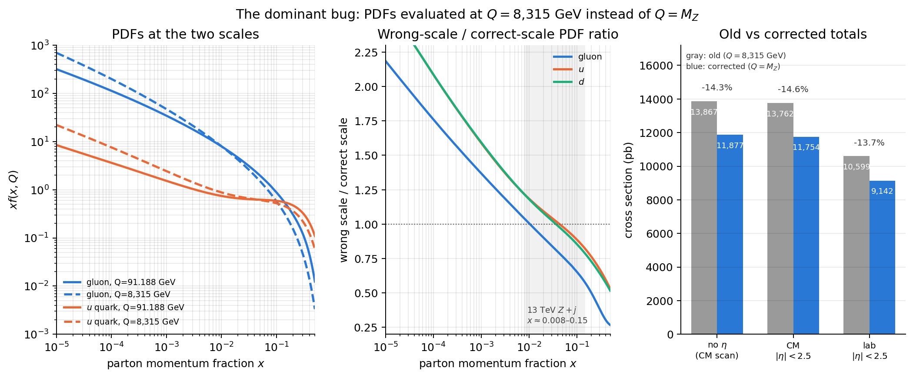
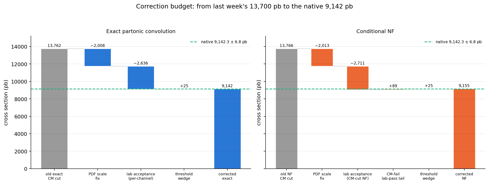
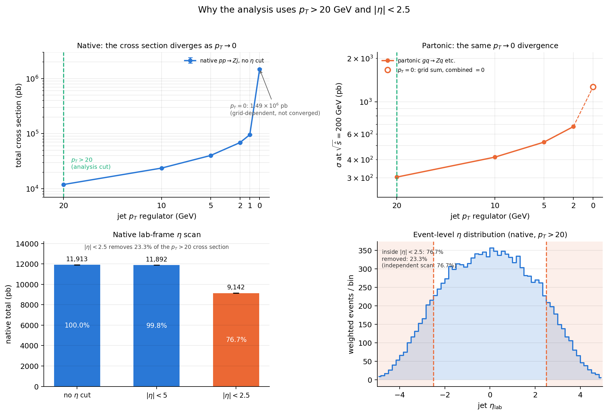
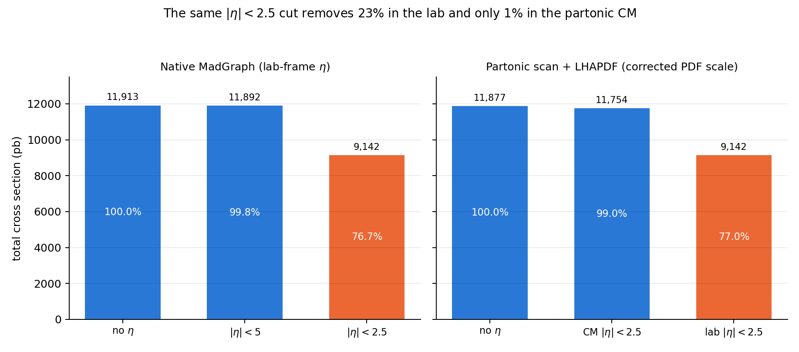
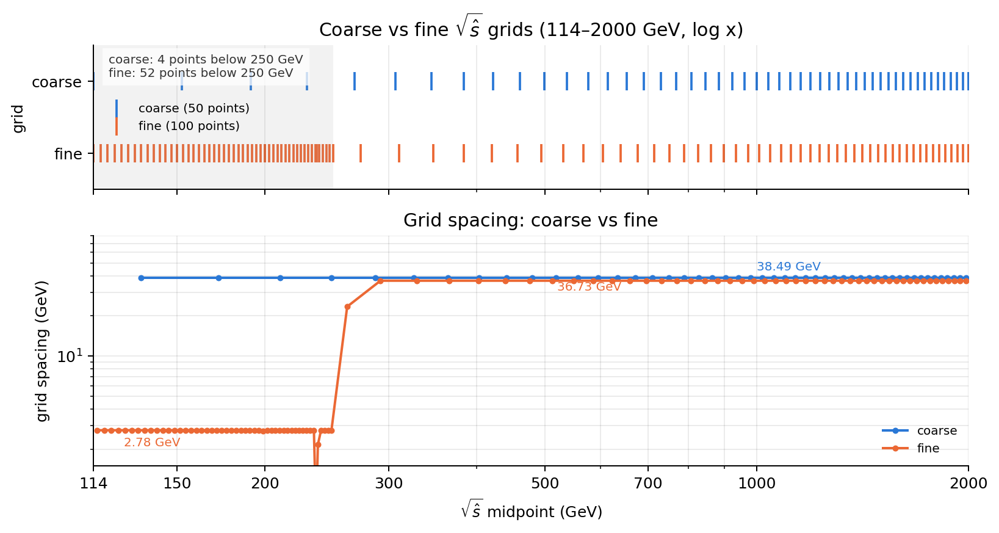
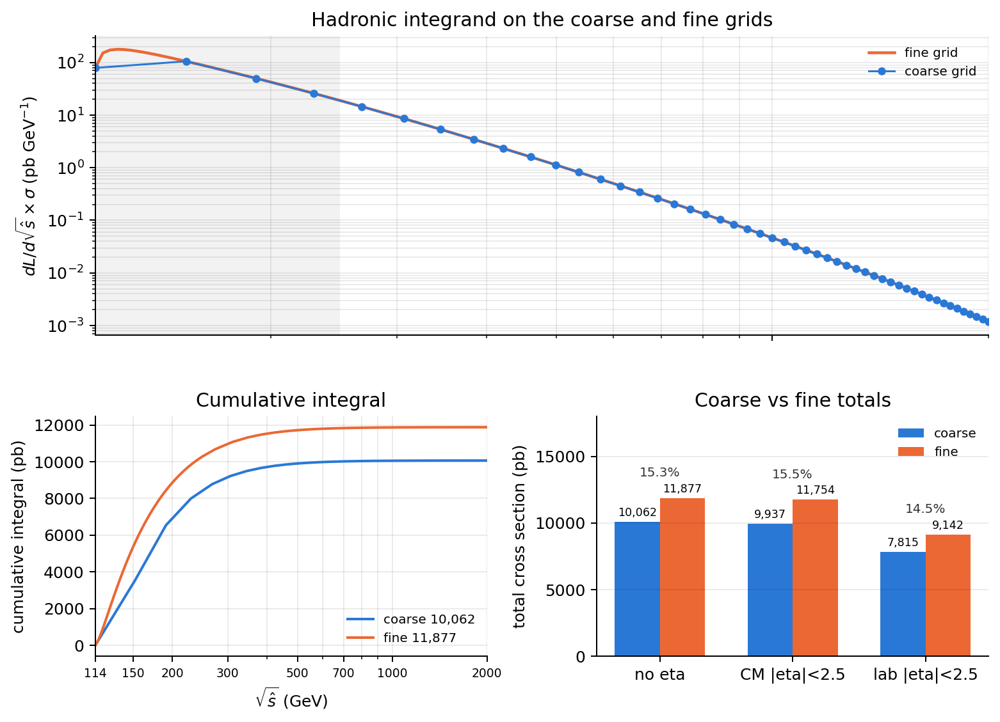
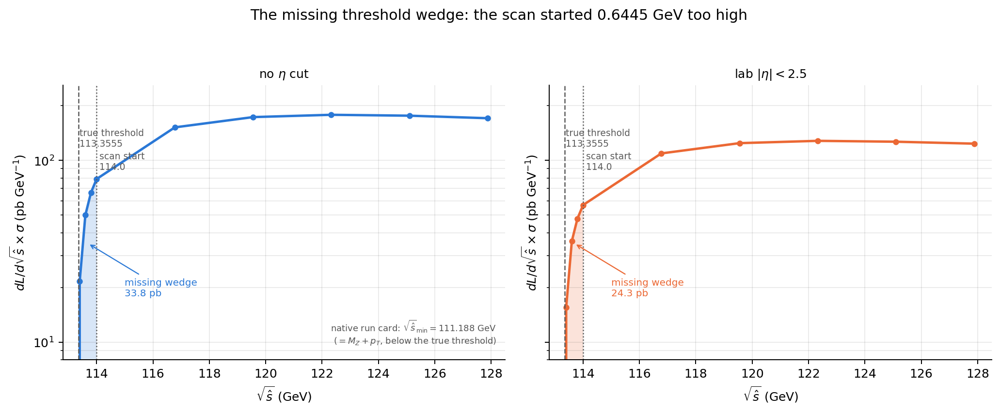
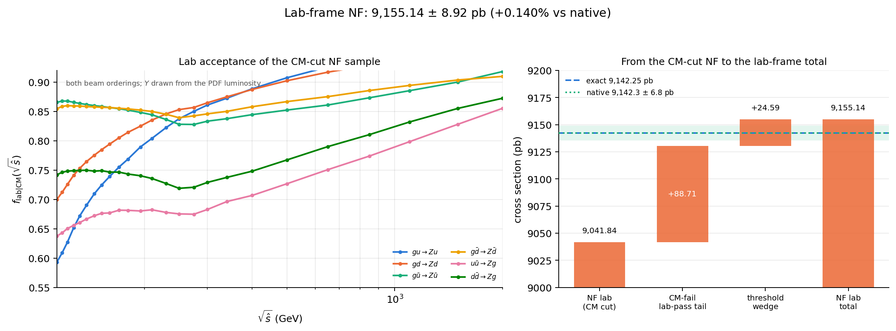
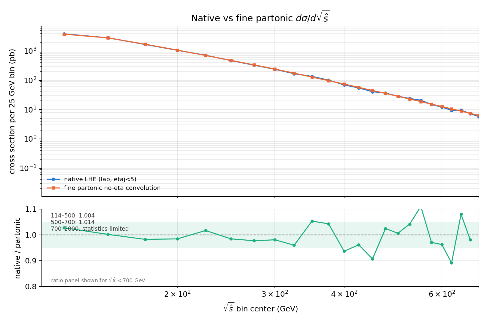
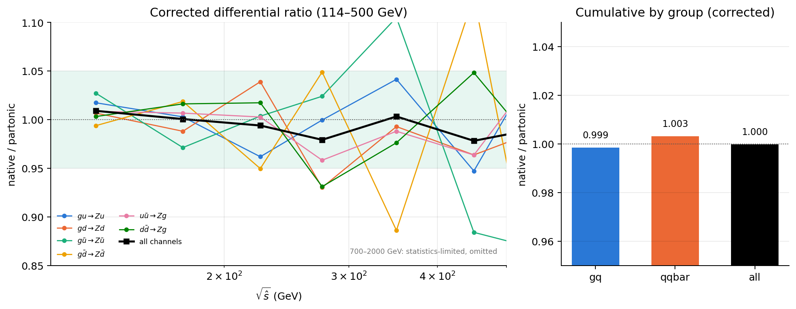

# Findings — MadGraph \(Z+j\): bugs, fixes, and the corrected lab-frame result

**Date:** 2026-11-10  
**Scope:** `C:/Users/laiji/test/madgraph_test`, with the upstream NF convolution
in `C:/Users/laiji/test/conditional-nf-integration`.  
**Status:** the old \(\sim14\%\) native/partonic gap is resolved. It was a
**PDF-scale bug in our Python/LHAPDF convolution**, not a native MadEvent
problem. This document defines every term used, derives every correction,
points to the exact code lines, and lists the corrected results.

---

## 0. Executive summary

Last week the comparison looked like this:

| quantity | old value (pb) | native (pb) | old ratio |
|---|---:|---:|---:|
| partonic no \(\eta\), 114–2000 | 13,866.59 | 11,913 ± 10.9 | 1.164 |
| exact partonic CM \(|\eta|<2.5\) | 13,761.97 | — | — |
| exact partonic lab \(|\eta|<2.5\) | 10,599.26 | 9,142.3 ± 6.8 | 1.159 |
| NF + LHAPDF, CM \(|\eta|<2.5\) | 13,765.5 ± 0.59 | — | — |

After the fixes:

| quantity | corrected (pb) | native (pb) | corrected ratio |
|---|---:|---:|---:|
| partonic no \(\eta\), 114–2000 | **11,876.96 ± 0.61** | 11,876.23 (events \(\ge114\)) | 1.00006 |
| no \(\eta\), threshold-adjusted 113.3555–2000 | **11,910.79** | 11,912.39 ± 10.9 | 0.99987 |
| exact partonic CM \(|\eta|<2.5\) | **11,753.90** | — | — |
| exact partonic lab, single acceptance + threshold | **9,137.90** | 9,142.3 ± 6.8 | 0.99952 |
| exact partonic lab, per-channel acceptance + threshold | **9,142.25** | 9,142.3 ± 6.8 | 0.99999 |
| NF + LHAPDF, CM \(|\eta|<2.5\) | **11,752.44 ± 0.82** | — | NF/exact 0.99988 |
| NF + LHAPDF, lab frame (event-level + tail + threshold) | **9,155.14 ± 8.92** | 9,142.3 ± 6.8 | 1.00140 |

The dominant correction is the **PDF scale**: the old convolution evaluated
the PDFs at \(Q=8{,}315.25\) GeV instead of \(Q=M_Z=91.188\) GeV. The second is
the **frame of the \(\eta\) cut**: the partonic scan applies it in the
partonic CM, while the native run applies it in the lab. The remaining
corrections are the coarse grid, the missing threshold wedge, the
channel-dependent acceptance, and the NF CM-cut tail.

The native MadEvent calculation was audited and found correct: scales,
couplings, PDF set, flavor mapping, symmetry factors, and LHE kinematics all
agree with the partonic calculation once the PDF-scale bug is fixed.

**Plots that summarise the whole story**





---

## 1. Definitions and notation

Everything used below is defined here; no term is assumed to be common sense.

### 1.1 Cross section and units

A **cross section** \(\sigma\) is the effective area presented by a process.
It is measured in **picobarns**, \(1\ \mathrm{pb}=10^{-36}\ \mathrm{cm}^2\).
MadGraph/MadEvent returns cross sections in pb. The **integrated cross
section** is the total over all allowed final states; the **differential
cross section** \(d\sigma/dX\) is the distribution in a kinematic variable
\(X\), and its integral over \(X\) is the total.

At **leading order (LO)** we keep only the tree-level Feynman diagrams. The
process is \(pp\to Z+j\), i.e. a \(Z\) boson plus one jet. A **jet** here is the
final-state parton (quark or gluon) after the hard scattering; no shower or
hadronization is applied.

### 1.2 The process and its six partonic channels

At hadron level the beams are protons. At parton level the hard process is one
of six channels:

\[
gu\to Zu,\quad gd\to Zd,\quad g\bar u\to Z\bar u,\quad
g\bar d\to Z\bar d,\quad u\bar u\to Zg,\quad d\bar d\to Zg,
\]

where \(u\) stands for up and charm, \(d\) for down and strange. The first four
are **gluon–quark** (\(gq\)) channels; the last two are **quark–antiquark**
(\(q\bar q\)) channels. Each channel has its own partonic cross section
\(\hat\sigma_c(\sqrt{\hat s})\) and its own PDF luminosity.

### 1.3 Frames: lab, partonic CM, rapidity, pseudorapidity

- **Lab frame (hadronic frame):** the frame in which the two protons have
  equal and opposite momenta, each with energy \(E_{\rm beam}=6{,}500\) GeV at
  \(\sqrt s=13\) TeV. The detector is at rest in this frame.
- **Partonic CM frame:** the rest frame of the two colliding partons. Its
  total momentum is zero. The partonic CM moves along the beam axis in the lab
  with **rapidity** \(Y\).
- **Rapidity** of a particle with energy \(E\) and longitudinal momentum
  \(p_z\):
  \[
  y=\frac12\ln\frac{E+p_z}{E-p_z}.
  \]
- **Pseudorapidity**:
  \[
  \eta=\frac12\ln\frac{|\vec p|+p_z}{|\vec p|-p_z},
  \qquad |\vec p|=\sqrt{p_x^2+p_y^2+p_z^2}.
  \]
  For a massless particle \(E=|\vec p|\), so \(y=\eta\). The LHE jets are
  massless at LO, so in this analysis \(y_{\rm lab}=\eta_{\rm lab}\) to
  \(4\times10^{-7}\).
- **Boost relation:** a particle with rapidity \(y_{\rm CM}\) in the partonic
  CM has lab rapidity
  \[
  y_{\rm lab}=y_{\rm CM}+Y.
  \]
  This single equation is the origin of the frame mismatch in §5.
- **Transverse momentum** \(p_T=\sqrt{p_x^2+p_y^2}\). It is invariant under
  boosts along the beam axis.

### 1.4 PDFs, factorization, and LHAPDF

A **parton distribution function (PDF)** \(f_i(x,Q)\) gives the number density
of parton species \(i\) carrying a fraction \(x\) of the proton momentum when
probed at **factorization scale** \(Q\). The quantity actually tabulated is
often \(xf_i(x,Q)\).

**Factorization** separates the long-distance proton structure (the PDFs)
from the short-distance hard scattering (the partonic cross section):
\[
\sigma_{pp\to X}
=\sum_{a,b}\int dx_1\,dx_2\,
f_a(x_1,Q)\,f_b(x_2,Q)\,
\hat\sigma_{ab\to X}(x_1,x_2,Q).
\]

**LHAPDF** is the standard library that stores PDF sets and returns
\(xf_i(x,Q)\) and \(\alpha_s(Q)\). We use LHAPDF 6.5.6 and the set
`NNPDF23_lo_as_0130_qed`, member 0, LHAPDF ID **247000**, with
\(\alpha_s(M_Z)=0.130\). The native baseline also uses the internal
`nn23lo1` set; a cross-check with external LHAPDF 247000 gives the same
native total (11,914.0 vs 11,913 pb).

The local Windows shim exposes two methods:

```python
pdf.xfxQ(pid, x, q)      # q in GeV
pdf.xfxQ2(pid, x, q2)    # q2 in GeV^2
```

`xfxQ` is LHAPDF's C++ method and **squares its argument internally**;
`xfxQ2` takes the squared scale and calls `xfxQ(pid, x, sqrt(q2))`.
This distinction is the dominant bug (§4).

### 1.5 Parton luminosity

Define the **partonic center-of-mass energy** \(\sqrt{\hat s}\) and the
**partonic momentum fractions** \(x_1,x_2\). For massless partons,
\[
\hat s=x_1x_2s,\qquad \tau\equiv\frac{\hat s}{s}=x_1x_2,
\]
where \(s=(13\ \mathrm{TeV})^2\). The **parton luminosity** is the PDF
convolution at fixed \(\sqrt{\hat s}\):
\[
\frac{dL_{ab}}{d\sqrt{\hat s}}
=\frac{2\sqrt{\hat s}}{s}\int dY\,
f_a\!\left(\sqrt\tau e^{Y},Q\right)
f_b\!\left(\sqrt\tau e^{-Y},Q\right),
\qquad
Y=\frac12\ln\frac{x_1}{x_2}.
\]
The derivation is in §3.2 and Appendix A. The factor \(2\sqrt{\hat s}/s\) is
the Jacobian from \(dx_1dx_2\) to \(d\tau\,dY\).

The hadronic differential cross section is then
\[
\frac{d\sigma}{d\sqrt{\hat s}}
=\sum_c \frac{dL_c}{d\sqrt{\hat s}}\,
\hat\sigma_c(\sqrt{\hat s}),
\]
and the total is its integral over \(\sqrt{\hat s}\).

### 1.6 Cuts, acceptance, and phase space

A **cut** is a restriction on the final-state phase space. We use:

- \(p_{T,j}>20\) GeV: the jet must have transverse momentum above 20 GeV.
- \(|\eta_{\rm lab}|<2.5\): the jet must lie in the central detector
  pseudorapidity region.

The **acceptance** \(f\) is the fraction of events passing a cut:
\[
f=\frac{\sigma_{\rm pass}}{\sigma_{\rm all}}.
\]
If the acceptance depends on the channel and on \(\sqrt{\hat s}\), it must be
applied inside the channel sum:
\[
\sigma_{\rm lab}
=\sum_c\int d\sqrt{\hat s}\,
\frac{dL_c}{d\sqrt{\hat s}}\,
\hat\sigma_c(\sqrt{\hat s})\,
f_{{\rm lab},c}(\sqrt{\hat s}).
\]
Using one channel-averaged \(f\) instead is an approximation; §8 quantifies it.

**Phase space** is the allowed region of final-state momenta. At LO the
\(Z+j\) final state is two-body, so the phase space is two-dimensional; the NF
is trained on that two-dimensional space.

### 1.7 MadGraph, MadEvent, LHE, run card, param card

- **MadGraph5_aMC@NLO** generates the process and the Monte Carlo code.
- **MadEvent** is the integration/event-generation engine. A **survey** is one
  MadEvent integration run over its phase-space grid.
- **LHE** (Les Houches Event) is the standard event-file format. Each event
  records the initial partons, final particles, weight, and event scale.
- The **run card** sets beam type (`lpp1/2`), beam energy (`ebeam1/2`), PDF
  (`pdlabel1/2`, `lhaid`), factorization/renormalization scales
  (`fixed_ren_scale`, `fixed_fac_scale1/2`, `dsqrt_q2fact1/2`), and cuts
  (`ptj`, `etaj`, `dsqrt_shat`).
- The **param card** sets masses, widths, couplings, and \(\alpha_s\).
- `lpp=1` means a hadronic beam (PDF convolution); `lpp=0` means a partonic
  beam with fixed energy. The partonic scan uses `lpp=0`, so its `etaj` cut is
  in the partonic CM, not the lab.

### 1.8 Conditional normalizing flow (NF)

A **normalizing flow** is an invertible map between a simple probability
distribution (here a unit Gaussian) and the target distribution. A
**conditional** flow also takes a condition; here the condition is
\(\sqrt{\hat s}\) (encoded as a three-feature vector). The NF is trained
per channel and per \(\sqrt{\hat s}\) range to reproduce the normalized
partonic phase-space density.

The NF gives a partonic cross section \(\hat\sigma_c^{\rm NF}(\sqrt{\hat s})\)
after multiplying by the integrated training weight. It does **not** use the
PDF; it is a surrogate for the partonic MadEvent calculation. The PDF enters
only in the luminosity convolution.

The NF was trained with the CM cut \(|\eta_{\rm CM}|<2.5\). It therefore cannot
sample events with \(|\eta_{\rm CM}|>2.5\), even if they pass the lab cut.
§9 treats that tail.

### 1.9 Integration, interpolation, grids, and errors

- **Gauss–Legendre quadrature** approximates an integral by a weighted sum at
  \(n\) nodes. We use \(n=200\) for the rapidity integral; §11 shows the
  convergence.
- **Trapezoid rule** approximates \(\int f(x)dx\) by connecting adjacent
  samples with straight lines. It is used for the \(\sqrt{\hat s}\) integral.
- A **grid** is the set of \(\sqrt{\hat s}\) points at which the partonic
  cross section is evaluated. The **coarse** grid has 50 linear points from
  114 to 2000 GeV; the **fine** grid has 100 points, split into a dense
  low-energy part and a coarser high-energy part.
- **Statistical error** comes from finite Monte Carlo sampling. **Systematic
  error** comes from a modeling or method choice (e.g. the acceptance
  interpolation or the event sample). They are added in quadrature when
  independent.

### 1.10 Threshold

The **kinematic threshold** is the smallest \(\sqrt{\hat s}\) at which the
final state can satisfy the cuts. For an on-shell \(Z\) of mass \(M_Z\) and a
jet of transverse momentum \(p_T\), the \(Z\) and jet are back-to-back in the
partonic CM, so
\[
E_Z=\sqrt{M_Z^2+p_T^2},\qquad E_j=p_T,\qquad
\sqrt{\hat s}_{\min}=E_Z+E_j
=\sqrt{M_Z^2+p_T^2}+p_T.
\]
With \(M_Z=91.188\) GeV and \(p_T=20\) GeV,
\[
\sqrt{\hat s}_{\min}=113.3555\ \mathrm{GeV}.
\]
This is **not** \(M_Z+p_T=111.188\) GeV; the difference is 2.1675 GeV.

### 1.11 Labels used in this note

| label | meaning |
|---|---|
| **native** | MadGraph `p p > Z j` with hadronic beams (`lpp=1`), lab-frame cuts |
| **exact partonic** | fixed-\(\sqrt{\hat s}\) MadEvent scan with `lpp=0`, convolved with LHAPDF |
| **NF** | conditional normalizing flow surrogate for the exact partonic cross section |
| **no-eta** | no \(|\eta|\) cut; only \(p_T>20\) GeV |
| **CM cut** | \(|\eta_{\rm CM}|<2.5\), applied in the partonic CM |
| **lab cut** | \(|\eta_{\rm lab}|<2.5\), applied in the hadronic lab |
| **coarse** | 50-point linear grid 114–2000 GeV |
| **fine** | 100-point split grid, 52 points at or below 250 GeV |
| **old** | pre-fix numbers, before the `xfxQ`→`xfxQ2` correction |

### 1.12 Error conventions

A quoted \(\pm\) is one standard deviation. When two independent errors are
combined, they are added in quadrature:
\[
\sigma_{\rm tot}=\sqrt{\sigma_1^2+\sigma_2^2+\cdots}.
\]
A difference is quoted in \(\sigma\) units as
\((\text{value}_1-\text{value}_2)/\sqrt{\sigma_1^2+\sigma_2^2}\).

---

## 2. Why the cuts are needed

### 2.1 The \(p_T\to0\) divergence

At LO, \(Z+j\) has a **soft/collinear divergence** as the jet \(p_T\to0\).
The partonic cross section behaves schematically as
\[
\frac{d\hat\sigma}{dp_T^2}\sim \frac{\alpha_s}{p_T^2}
\quad(p_T\to0),
\]
so the total cross section without a \(p_T\) cut is not finite. MadEvent
returns a grid-dependent number for `ptj=0`; it is not a physical cross
section.



The native \(p_T\)-regulator scan is:

| \(p_{T,\min}\) (GeV) | native total (pb) |
|---:|---:|
| 20 | 11,913 ± 10.9 |
| 10 | 23,692 ± 30.1 |
| 5 | 40,116 ± 45.9 |
| 2 | 68,856 ± 79.6 |
| 1 | 95,661 ± 108 |
| 0 | \(1.485\times10^6\) ± 43,311 (grid-dependent, not converged) |

The partonic scan at \(\sqrt{\hat s}=200\) GeV shows the same behaviour:
\(p_T=20\) gives 303.11 pb, 10 gives 416.13, 5 gives 527.96, 2 gives 675.71,
and \(p_T=0\) gives a sum of grid configurations (1,268.76 pb) whose combined
result is 0. The endpoint is a regulator artefact, not a cross section.

The physical choice \(p_T>20\) GeV is a standard jet-reconstruction cut: it
keeps jets above the detector/trigger threshold and makes the LO calculation
finite. It is applied to the **leading jet**; at LO the \(Z\) and jet are
back-to-back, so the jet is the only light final-state parton.

### 2.2 The \(|\eta|<2.5\) cut

The pseudorapidity cut is the detector acceptance: the central tracker and
calorimeters cover \(|\eta|\lesssim2.5\). It also removes very forward events
where the jet is outside the detector.

The native lab-frame scan is:

| cut | native total (pb) | fraction of no-\(\eta\) |
|---|---:|---:|
| no \(\eta\) | 11,913 ± 10.9 | 100.0% |
| \(|\eta|<5\) | 11,892 ± 10.5 | 99.8% |
| \(|\eta|<2.5\) | 9,142.3 ± 6.8 | 76.7% |

The event-level \(\eta_{\rm lab}\) distribution confirms the 23.3% removal.
The exact number depends on whether one uses pseudorapidity or rapidity; the
jets are massless at LO, so they agree to \(4\times10^{-7}\). The clean
no-eta event sample gives 76.7% inside \(|\eta|<2.5\).

The key point for the rest of this note: **the native cut is in the lab, but
the partonic scan's cut is in the partonic CM.** The same numerical cut value
therefore means different things. This is §5.

---

## 3. From the partonic/NF cross section to the total

This section is the calculation pipeline; the bugs are in §4–§9.

### 3.1 Step 1: the partonic cross section

For each channel \(c\) and each \(\sqrt{\hat s}\), the exact partonic
cross section \(\hat\sigma_c(\sqrt{\hat s})\) is obtained from a MadEvent run
with:

- `lpp1=lpp2=0` (partonic beams),
- `ebeam1=ebeam2=√ŝ/2`,
- `ptj=20`, `etaj=-1` (no eta cut),
- fixed scale 91.188 GeV,
- \(\alpha_s=0.130\) from the param card.

The code that sets these is
[`scan_partonic.py:58-84`](scan_partonic.py#L58-L84); the important lines are:

```python
set_value(RUN_CARD, "lpp1", "0")
set_value(RUN_CARD, "lpp2", "0")
set_value(RUN_CARD, "ebeam1", f"{beam:.12g}")
set_value(RUN_CARD, "ebeam2", f"{beam:.12g}")
set_value(RUN_CARD, "ptj", f"{ptj:.12g}")
set_value(RUN_CARD, "etaj", "-1.0")
```

The NF replaces this step: for each channel and \(\sqrt{\hat s}\), it samples
the two-body phase space and returns a partonic cross section with the same
normalization. The NF is trained in the partonic CM with the CM cut
\(|\eta_{\rm CM}|<2.5\), so its default output is a **CM-cut** cross section.

### 3.2 Step 2: the PDF luminosity

Start from the factorization formula:
\[
\sigma_{pp\to Zj}
=\sum_{a,b}\int_0^1 dx_1\int_0^1 dx_2\,
f_a(x_1,Q)f_b(x_2,Q)\,
\hat\sigma_{ab}\big(\hat s=x_1x_2s\big).
\]
Change variables from \((x_1,x_2)\) to \((\tau,Y)\):
\[
x_1=\sqrt\tau\,e^{Y},\qquad
x_2=\sqrt\tau\,e^{-Y},\qquad
\tau=x_1x_2.
\]
The Jacobian is
\[
\left|\frac{\partial(x_1,x_2)}{\partial(\tau,Y)}\right|=1,
\]
so \(dx_1dx_2=d\tau\,dY\). Since \(\sqrt{\hat s}=\sqrt{\tau s}\),
\[
d\tau=\frac{2\sqrt{\hat s}}{s}\,d\sqrt{\hat s}.
\]
Therefore
\[
\frac{dL_{ab}}{d\sqrt{\hat s}}
=\frac{2\sqrt{\hat s}}{s}\int_{Y_{\min}}^{Y_{\max}}dY\,
f_a\!\left(\sqrt\tau e^{Y},Q\right)
f_b\!\left(\sqrt\tau e^{-Y},Q\right),
\]
with \(Y_{\max}=\frac12\ln(s/\hat s)\). The two beam orderings
\((a,b)\) and \((b,a)\) are both included.

The code is
[`integrate_and_plot.py:54-71`](integrate_and_plot.py#L54-L71):

```python
def luminosity(pdf, sqrts_hat, sqrts, q2, pairs, y_nodes, y_weights):
    s = sqrts * sqrts
    shat = sqrts_hat * sqrts_hat
    xroot = math.sqrt(shat / s)
    ymax = 0.5 * math.log(s / shat)
    y = ymax * y_nodes
    weights = ymax * y_weights
    total = 0.0
    for first, second in pairs:
        for left, right in ((first, second), (second, first)):
            x1 = xroot * np.exp(y)
            x2 = xroot * np.exp(-y)
            xf1 = np.array([pdf.xfxQ2(int(left), float(x), q2) for x in x1])
            xf2 = np.array([pdf.xfxQ2(int(right), float(x), q2) for x in x2])
            total += float(np.sum(weights * (xf1 / x1) * (xf2 / x2)))
    return (2.0 * sqrts_hat / s) * total
```

Note `xf1/x1 = f(x1)` because `xf1` is \(x_1f(x_1)\). The factor
`2*sqrts_hat/s` is the Jacobian. The `y_nodes,y_weights` are 200-point
Gauss–Legendre nodes; `q2=91.188**2`.

### 3.3 Step 3: the hadronic integrand and its integral

The hadronic integrand is
\[
I(\sqrt{\hat s})
=\sum_c \frac{dL_c}{d\sqrt{\hat s}}\,
\hat\sigma_c(\sqrt{\hat s}).
\]
The total is
\[
\sigma=\int_{\sqrt{\hat s}_{\min}}^{2000}
I(\sqrt{\hat s})\,d\sqrt{\hat s},
\]
evaluated with the trapezoid rule on the fine grid
([`integrate_and_plot.py:138-142`](integrate_and_plot.py#L138-L142)):

```python
weights[1:-1] = 0.5 * (energies[2:] - energies[:-2])
weights[0]     = 0.5 * (energies[1] - energies[0])
weights[-1]    = 0.5 * (energies[-1] - energies[-2])
value = float(np.sum(weights * lum * sigma))
```

### 3.4 Step 4: the lab acceptance

The partonic no-eta result is multiplied by the lab acceptance. In the
single-acceptance approximation,
\[
\sigma_{\rm lab}=\int d\sqrt{\hat s}\,
I(\sqrt{\hat s})\,f_{\rm lab}(\sqrt{\hat s}),
\]
with \(f_{\rm lab}\) interpolated from the native event sample. The code is
[`apply_lab_eta_correction.py:68-73`](apply_lab_eta_correction.py#L68-L73):

```python
lab = np.interp(energies, shat, lab_acc, left=lab_acc[0], right=lab_acc[-1])
cm  = np.interp(energies, shat, cm_acc,  left=cm_acc[0],  right=cm_acc[-1])
total     = float(np.sum(weights * integrand))
total_lab = float(np.sum(weights * integrand * lab))
total_cm  = float(np.sum(weights * integrand * cm))
```

The per-channel version uses \(f_{{\rm lab},c}\) inside the channel sum; §8.

### 3.5 What LHAPDF does, exactly

LHAPDF supplies the PDF values \(xf_i(x,Q)\) and \(\alpha_s(Q)\). It does not
perform the convolution; our code does. The local shim is a small C ABI over
LHAPDF 6.5.6. The relevant lines are:

- [`lhapdf-local/src/lhapdf_ctypes.cpp:20-25`](../lhapdf-local/src/lhapdf_ctypes.cpp#L20-L25):

```cpp
LHAPDF_CTYPES_API double lhapdf_xfxQ(void* pdf, int id, double x, double q2) {
  if (pdf == nullptr) return 0.0;
  return static_cast<LHAPDF::PDF*>(pdf)->xfxQ(id, x, q2);
}
```

The parameter is **named** `q2`, but `LHAPDF::PDF::xfxQ` interprets it as
\(Q\) in GeV and squares it internally. The name is misleading; the value is
\(Q\), not \(Q^2\).

- [`lhapdf-local/python/lhapdf.py:45-51`](../lhapdf-local/python/lhapdf.py#L45-L51):

```python
def xfxQ(self, pid: int, x: float, q: float) -> float:
    """Return x*f at scale q (GeV).  The C wrapper calls LHAPDF::xfxQ."""
    return float(_LIB.lhapdf_xfxQ(self._ptr, int(pid), float(x), float(q)))

def xfxQ2(self, pid: int, x: float, q2: float) -> float:
    """Return x*f at scale q2 (GeV^2)."""
    return self.xfxQ(pid, x, math.sqrt(float(q2)))
```

**Rule:** if your variable is a squared scale, call `xfxQ2`. If it is \(Q\) in
GeV, call `xfxQ`. The old code called `xfxQ(..., q2)` with
`q2 = 91.188**2`, which evaluates at \(Q=8{,}315.25\) GeV.

### 3.6 Exact versus NF

The exact partonic cross section is a MadEvent scan; the NF is a surrogate.
Both feed the same luminosity and integration code. The NF's advantage is
that it produces a smooth, continuous \(\hat\sigma_c(\sqrt{\hat s})\) without
a new MadEvent run at every energy. The NF is validated against the exact
scan:

| quantity | NF (pb) | exact (pb) | ratio |
|---|---:|---:|---:|
| CM with cut, 114–2000 | 11,752.44 ± 0.82 | 11,753.90 | 0.99988 |

### 3.7 Step 5: the threshold piece

The fine scan starts at 114.0 GeV, but the true threshold is 113.3555 GeV.
The missing interval contributes 33.84 pb no-eta and 24.3–24.6 pb in the lab;
§7. This is added as a separate trapezoid over the threshold scan.

### 3.8 The pipeline in one table

| step | input | code | output |
|---|---|---|---|
| partonic \(\hat\sigma_c(\sqrt{\hat s})\) | MadEvent fixed-\(\sqrt{\hat s}\) or NF | `scan_partonic.py`, NF checkpoints | pb per channel |
| luminosity \(dL_c/d\sqrt{\hat s}\) | LHAPDF \(xf(x,Q)\), \(Q=91.188\) GeV | `integrate_and_plot.py:54-71` | pb\(^{-1}\) GeV\(^{-1}\) |
| hadronic integrand | \(L_c\hat\sigma_c\) | `integrate_and_plot.py:133-142` | pb GeV\(^{-1}\) |
| total | trapezoid over fine grid | `integrate_and_plot.py:138-142` | pb |
| lab acceptance | native event fractions \(f_{\rm lab,c}\) | `apply_lab_eta_correction.py:68-73` | pb |
| threshold | threshold scan 113.4–114 | `debug_normalization_gap.py:324-380` | pb |
| NF lab | event-level boost + tail + threshold | `apply_lab_frame_nf.py:151-240` | pb |

---

## 4. Bug 1 (dominant): PDF evaluated at \(Q^2\) instead of \(Q\)

### 4.1 Symptom

The old partonic no-eta total was 13,866.59 pb, while the native no-eta total
was 11,913 ± 10.9 pb: a 16.4% excess. The old lab total was 10,599.26 pb vs
native 9,142.3 ± 6.8 pb: a 15.9% excess. The old NF CM total was 13,765.5 pb.
The discrepancy was not constant: the native/partonic differential ratio went
from 0.79 at low \(\sqrt{\hat s}\) to 1.36 at high \(\sqrt{\hat s}\). That tilt
was the clue.

### 4.2 The math

LHAPDF's `xfxQ(pid, x, Q)` expects \(Q\) in GeV. The old call passed
\[
Q_{\rm old}=q^2=(91.188\ \mathrm{GeV})^2=8{,}315.25\ \mathrm{GeV}.
\]
So the PDFs were evaluated at
\[
Q_{\rm old}=8{,}315.25\ \mathrm{GeV},\qquad
Q_{\rm old}^2=6.914\times10^7\ \mathrm{GeV}^2,
\]
instead of \(Q=M_Z=91.188\) GeV, \(Q^2=8{,}315.25\) GeV\(^2\).

At small \(x\), the DGLAP evolution increases the gluon and sea PDFs with
\(Q\); at large \(x\), the valence PDFs decrease. The wrong scale therefore
inflates the low-\(\sqrt{\hat s}\) region and depletes the high-\(\sqrt{\hat s}\)
region, exactly the observed tilt.

### 4.3 The code and the exact lines

The old call was:

```python
pdf.xfxQ(pid, x, q2)     # q2 = 91.188**2  -> WRONG: xfxQ takes Q
```

The wrapper's parameter name made this easy to miss
([`lhapdf_ctypes.cpp:20-25`](../lhapdf-local/src/lhapdf_ctypes.cpp#L20-L25)).
The fix is to call `xfxQ2`:

- [`integrate_and_plot.py:68-69`](integrate_and_plot.py#L68-L69)
- [`verification/check_luminosity.py:43-45`](verification/check_luminosity.py#L43-L45)
  and `:101-102`
- [`conditional-nf-integration/experiments/integrate_hadronic_process.py:81-83`](../conditional-nf-integration/experiments/integrate_hadronic_process.py#L81-L83)
- the upstream number 13,765.5 pb was corrected to 11,752.44 pb.

The shim now documents the distinction at
[`lhapdf-local/python/lhapdf.py:8-10`](../lhapdf-local/python/lhapdf.py#L8-L10)
and implements `xfxQ2` at `:49-51`.

### 4.4 Quantitative effect

The ratio of the old (wrong) luminosity to the correct one is:

| \(\sqrt{\hat s}\) (GeV) | \(L_{\rm old}/L_{\rm correct}\) |
|---:|---:|
| 114 | 1.241 |
| 150 | 1.151 |
| 200 | 1.060 |
| 300 | 0.940 |
| 500 | 0.798 |
| 700 | 0.710 |
| 1000 | 0.621 |
| 1500 | 0.521 |
| 2000 | 0.449 |

The PDF ratio at representative \(x\) is:

| \(x\) | gluon | \(u\) | \(d\) |
|---:|---:|---:|---:|
| \(10^{-4}\) | 1.761 | 2.086 | 2.087 |
| \(10^{-3}\) | 1.369 | 1.589 | 1.594 |
| \(10^{-2}\) | 1.007 | 1.185 | 1.182 |
| \(0.1\) | 0.654 | 0.888 | 0.856 |
| \(0.4\) | 0.305 | 0.598 | 0.575 |

The convolution weights the low-\(x\), low-\(\sqrt{\hat s}\) region strongly,
so the net effect is a 14–16% excess, not the 24% seen at 114 GeV alone.

The old and corrected totals:

| scenario | old (pb) | corrected (pb) | change |
|---|---:|---:|---:|
| no \(\eta\), 114–2000 | 13,866.59 | 11,876.96 | −14.3% |
| exact CM \(|\eta|<2.5\) | 13,761.97 | 11,753.90 | −14.6% |
| exact lab \(|\eta|<2.5\) | 10,599.26 | 9,142.25 | −13.7% |
| NF CM \(|\eta|<2.5\) | 13,765.5 | 11,752.44 | −14.6% |


### 4.5 Verification

- Native no-eta 11,913 ± 10.9; corrected partonic 11,876.96 ± 0.61:
  ratio 0.9970. Restricting the native sample to events above 114 GeV gives
  11,876.23 pb, ratio 1.00006.
- Native both-cuts 9,142.3 ± 6.8; corrected exact lab 9,142.25:
  ratio 0.99999.
- Native CM? The native run is lab; the partonic CM with-cut 11,753.90 is
  compared with the CM acceptance 11,753.55: 0.003%.
- Per-channel corrected native/partonic ratios: 0.9902–1.0041; total 0.9998
  (clean sample).
- Windowed checks: 114–150 partonic 5,331.18 vs native 5,365.5 ± 4.7
  (1.0064); 500–700 partonic 113.38 vs native 112.35 ± 0.12 (0.9909).

The native calculation was **not** wrong. The LHE headers show
SCALUP=91.188, AQEDUP=0.00754677, AQCDUP=0.130; the param cards agree on
\(M_Z\), \(\Gamma_Z\), \(a_{\rm EW}^{-1}\), \(G_F\); the run cards fix
\(q_{\rm fact}^2=91.188^2\); the internal `nn23lo1` and external LHAPDF
247000 give the same native total (11,913 vs 11,914 pb).

---

## 5. Bug 2: the pseudorapidity frame mismatch (partonic CM vs lab)

### 5.1 The math

The partonic scan uses `lpp=0`, so its `etaj=2.5` cut is applied in the
**partonic CM**. The native run uses `lpp=1`, so its `etaj=2.5` cut is applied
in the **lab**. The two are related by
\[
y_{\rm lab}=y_{\rm CM}+Y,
\]
where \(Y=\frac12\ln(x_1/x_2)\) is the rapidity of the partonic CM in the lab.
A jet can have \(|y_{\rm CM}|<2.5\) but \(|y_{\rm lab}|>2.5\) (or vice versa).
Therefore the same numerical cut is **not** the same physical cut.

### 5.2 The code

- The partonic scan sets `lpp1=lpp2=0`, `ebeam=√ŝ/2`, and `etaj=-1` (no eta)
  at [`scan_partonic.py:58-70`](scan_partonic.py#L58-L70).
- The lab/CM fractions are extracted from the native LHE events by
  [`analyze_eta_frame_events.py:58-86`](analyze_eta_frame_events.py#L58-L86).
- The boost to the partonic CM is
  [`verification/parse_events.py:96-103`](verification/parse_events.py#L96-L103):

```python
beta = math.tanh(Y)
gamma = math.cosh(Y)
ep = gamma * (jet["e"] - beta * jet["pz"])
pzp = gamma * (jet["pz"] - beta * jet["e"])
ycm = rap(pzp, ep)
```

- The acceptance is applied at
  [`apply_lab_eta_correction.py:68-73`](apply_lab_eta_correction.py#L68-L73).
- The NF lab acceptance uses the same relation at
  [`apply_lab_frame_nf.py:74-115`](verification/apply_lab_frame_nf.py#L74-L115).

### 5.3 The effect

From the clean no-eta event sample (134,848 events, weight sum 11,913.95 pb):

| frame of the \(|\eta|<2.5\) cut | event-level fraction | acceptance-weighted fraction | implied total (pb) |
|---|---:|---:|---:|
| lab | 0.7666 | 0.7673 | 9,113.3 (single acceptance) |
| partonic CM | 0.9897 | 0.9896 | 11,753.6 |

The native lab cut removes **23.3%**; the partonic CM cut removes only
**1.0%**. This is why the old CM with-cut number (13,761.97) was never the
lab result, and why comparing it directly to the native 9,142.3 pb was wrong.



### 5.4 The fix

Two equivalent routes:

1. **Apply the lab acceptance to the partonic no-eta integral.** This is the
   fast route; it gives the exact lab 9,137.90 pb (single acceptance +
   threshold) or 9,142.25 pb (per-channel acceptance + threshold).
2. **Run the native calculation with the lab cut** (the 9,142.3 pb reference).

For the NF, the lab acceptance must be applied **event by event**, because the
NF samples the partonic CM phase space. The NF route is §9.

### 5.5 Verification

- The partonic CM with-cut 11,753.90 pb agrees with the CM acceptance
  11,753.55 pb to 0.003%.
- The lab acceptance 0.7666 (clean sample) is consistent with the native
  event-level fraction 0.7666 and the native both-cuts ratio
  9,142.3/11,913 = 0.7674 within the event-sample uncertainty.
- The exact lab 9,142.25 pb agrees with native 9,142.3 ± 6.8 pb.

---

## 6. Bug 3: the coarse 50-point linear grid truncation

### 6.1 The math

The trapezoid error on a smooth function is
\[
\int f\,dx - T_h
=\frac{h^2}{12}\big[f'(b)-f'(a)\big]+O(h^4)
\]
for uniform spacing \(h\), or locally
\[
\text{error}\sim\frac{h^2}{12}f''(x).
\]
The hadronic integrand \(I(\sqrt{\hat s})\) rises steeply from threshold to
about 150 GeV and then falls. A coarse grid with only four points below
250 GeV under-samples the rise and underestimates the area.

### 6.2 The code

The old default was
[`scan_partonic.py:187-189`](scan_partonic.py#L187-L189):

```python
# 50 linear points
energies = list(__import__("numpy").linspace(114.0, 2000.0, 50))
```

Spacing: \((2000-114)/49=38.49\) GeV. Only 114, 152.5, 191.0, 229.5 are
below 250 GeV.

The fine grid is in
[`results/fine_energy_grid.txt`](results/fine_energy_grid.txt): 100 points,
52 at or below 250 GeV, with 2.7755 GeV spacing in the low part and 36.7347
GeV in the high part.

The trapezoid rule is
[`integrate_and_plot.py:138-142`](integrate_and_plot.py#L138-L142).

### 6.3 The effect

| scenario | coarse (pb) | fine (pb) | coarse low by |
|---|---:|---:|---:|
| no \(\eta\) | 10,062.31 ± 0.98 | 11,876.96 ± 0.61 | 15.3% |
| CM \(|\eta|<2.5\) | 9,937.01 | 11,753.55 | 15.4% |
| lab \(|\eta|<2.5\) | 7,815.27 | 9,142.25 | 14.5% |





The coarse agreement with native in the old lab comparison was a coincidence:
both the PDF-scale bug and the coarse grid were low/high in opposite
directions, and the old numbers happened to land near 9,000–10,000 pb.

### 6.4 The 0.5 GeV interpolation check

The official 100-point trapezoid gives 11,876.9572 pb. Interpolating the
integrand onto a 0.5 GeV grid (3,773 points) gives 11,876.2523 pb, a change of
**−0.705 pb (−0.0059%)**. PCHIP gives −1.898 pb (−0.016%). A log-linear
interpolation gives −41.3 pb, and log-PCHIP gives −9.9 pb; those are
interpolation artefacts and are not used. The linear-y trapezoid on the fine
grid is therefore converged at the few-pb level.

The check is [`verification/check_fine_grid.py:40-58`](verification/check_fine_grid.py#L40-L58).
The log-interpolation trap is visible in
[`verification/check_integration.py:68-76`](verification/check_integration.py#L68-L76).

---

## 7. Bug 4: the missing threshold wedge (113.3555–114.0 GeV)

### 7.1 Derivation

At LO the \(Z\) and jet are back-to-back in the partonic CM. For an on-shell
\(Z\) and a jet with transverse momentum \(p_T\),
\[
E_Z=\sqrt{M_Z^2+p_T^2},\qquad E_j=p_T,
\]
so
\[
\sqrt{\hat s}_{\min}=E_Z+E_j
=\sqrt{M_Z^2+p_T^2}+p_T.
\]
With \(M_Z=91.188\) GeV and \(p_T=20\) GeV:
\[
\sqrt{\hat s}_{\min}
=\sqrt{91.188^2+20^2}+20
=113.3555\ \mathrm{GeV}.
\]
The naive formula \(M_Z+p_T=111.188\) GeV is **2.1675 GeV too low**; it
ignores the \(Z\)'s momentum-dependent energy.

### 7.2 The native run card and the scan start

The native no-eta run card has
[`native_zj_nocuts/Cards/run_card.dat:94`](native_zj_nocuts/Cards/run_card.dat#L94):

```text
111.188  = dsqrt_shat ! minimal shat for full process
```

This is the naive \(M_Z+p_T\). It is **below** the true threshold, so it does
not remove physical phase space; it also does not help. The partonic scan
starts at 114.0 GeV, so it misses the interval 113.3555–114.0 GeV.

The runner writes `dsqrt_shat` at
[`run_native_nocuts.py:53`](run_native_nocuts.py#L53).

### 7.3 The missing contribution

The threshold scan is
[`verification/scan_threshold.csv`](verification/scan_threshold.csv) at
113.4, 113.6, 113.8 GeV, plus the 114.0 GeV point from the fine scan. The
integrand values are:

| \(\sqrt{\hat s}\) (GeV) | \(dL/d\sqrt{\hat s}\times\sigma\), no \(\eta\) (pb/GeV) |
|---:|---:|
| 113.3555 | 0 |
| 113.4 | 21.61 |
| 113.6 | 49.98 |
| 113.8 | 66.50 |
| 114.0 | 78.99 |

Trapezoid over the wedge gives
\[
\Delta\sigma_{\rm no\eta}=33.84\ \mathrm{pb}.
\]
With the lab acceptance, the wedge is about 24.3–24.6 pb; the central value
used here is **24.59 pb** from the per-channel threshold scan, with a
\(\pm0.3\) pb method spread between the per-channel and flat-acceptance
interpolations.

The code is
[`verification/debug_normalization_gap.py:324-380`](verification/debug_normalization_gap.py#L324-L380);
the NF total uses the same 24.589 pb at
[`verification/apply_lab_frame_nf.py:205`](verification/apply_lab_frame_nf.py#L205).

### 7.4 The effect

| quantity | 114–2000 (pb) | wedge (pb) | adjusted (pb) |
|---|---:|---:|---:|
| no \(\eta\) | 11,876.96 | +33.84 | 11,910.79 |
| lab, single acceptance | 9,113.31 | +24.59 | 9,137.90 |
| lab, per-channel | 9,117.66 | +24.59 | 9,142.25 |
| CM | 11,753.55 | +33.84 | 11,787.39 |

The wedge is **+0.285%** of the no-eta total and **+0.269%** of the lab total.
It adds cross section; an earlier note quoted “−0.28%”, which was a sign typo.
The correction is small but larger than the final native agreement, so it must
be included.



---

## 8. Bug 5: single-channel versus channel-dependent lab acceptance

### 8.1 The math

The correct lab integral is
\[
\sigma_{\rm lab}
=\sum_c\int d\sqrt{\hat s}\,
\frac{dL_c}{d\sqrt{\hat s}}\,
\hat\sigma_c(\sqrt{\hat s})\,
f_{{\rm lab},c}(\sqrt{\hat s}).
\]
The single-acceptance approximation replaces \(f_{{\rm lab},c}\) by one
all-channel \(f_{\rm lab}\):
\[
\sigma_{\rm lab}^{\rm single}
=\int d\sqrt{\hat s}\,
\left(\sum_c \frac{dL_c}{d\sqrt{\hat s}}\hat\sigma_c\right)
f_{\rm lab}(\sqrt{\hat s}).
\]
This is exact only if the acceptance is channel-independent or if the
channel mix is the same everywhere. Neither is true: \(q\bar q\to Zg\) has a
lower lab acceptance than \(gq\to Zq\).

### 8.2 The per-channel acceptance

From the clean no-eta event sample (25–50 GeV bins, effective values):

| channel | \(f_{\rm lab}\) |
|---|---:|
| \(gu\to Zu\) | 0.739 |
| \(gd\to Zd\) | 0.794 |
| \(g\bar u\to Z\bar u\) | 0.857 |
| \(g\bar d\to Z\bar d\) | 0.862 |
| \(u\bar u\to Zg\) | 0.664 |
| \(d\bar d\to Zg\) | 0.744 |
| all channels | 0.767 |

The \(q\bar q\) channels are about 10–15% less central than the \(gq\)
channels, as expected: the gluon is more forward.

### 8.3 The old claim and why it was wrong

The old analysis found a \(-31\) pb (\(-0.30\%\)) channel-dependent shift and
quoted a single acceptance. That was a **pre-PDF-fix artefact**: the wrong PDF
scale distorted the partonic channel mix, especially the \(q\bar q\) channels
(old \(q\bar q\) native/partonic ratio 0.741). With the correct PDF, the
partonic channel mix matches the native event sample:

| channel | native % | partonic % |
|---|---:|---:|
| \(gu\) | 27.31 | 27.26 |
| \(gd\) | 23.45 | 23.53 |
| \(g\bar u\) | 8.52 | 8.49 |
| \(g\bar d\) | 12.41 | 12.54 |
| \(u\bar u\) | 14.38 | 14.31 |
| \(d\bar d\) | 13.94 | 13.88 |

The clean-sample channel correction is
\[
\Delta_{\rm channel}=+4.35\pm4.24\ (\text{stat})\pm5\text{–}10\ (\text{method})\ \mathrm{pb},
\]
i.e. **+0.048% ± 0.047%**, consistent with zero. The old \(-0.30\%\) claim is
retracted; it was the PDF-scale bug masquerading as an acceptance bias.

### 8.4 The corrected numbers

| method | lab 114–2000 (pb) | + threshold (pb) |
|---|---:|---:|
| single stored acceptance | 9,113.31 | 9,137.90 |
| per-channel acceptance (point estimate) | 9,117.66 | **9,142.25** |
| native | 9,142.3 ± 6.8 | — |

The per-channel value is adopted for the exact comparison because it is the
physically correct channel sum. The single-acceptance value is kept as a
cross-check; the 4.4 pb difference is the acceptance-model systematic.

The code is
[`verification/channel_acceptance.py`](verification/channel_acceptance.py),
[`verification/bootstrap_channel.py`](verification/bootstrap_channel.py), and
[`verification/apply_lab_frame_nf.py:151-240`](verification/apply_lab_frame_nf.py#L151-L240).

---

## 9. Bug 6: the NF CM-cut tail

### 9.1 The decomposition

The NF is trained with \(|\eta_{\rm CM}|<2.5\), so it samples only the
CM-pass region. The lab acceptance of the full sample decomposes as
\[
f_{\rm lab}
=P(\text{lab pass}\mid\text{CM pass})P(\text{CM pass})
+P(\text{lab pass}\mid\text{CM fail})P(\text{CM fail}).
\]
The NF gives the first term. The second term is the **CM-fail/lab-pass tail**;
it must be measured from native events. The missing cross section is
\[
\Delta\sigma_{\rm tail}
=\int d\sqrt{\hat s}\,
\frac{dL}{d\sqrt{\hat s}}\,
\hat\sigma_{\rm NF}(\sqrt{\hat s})\,
r(\sqrt{\hat s}),
\]
where
\[
r(\sqrt{\hat s})
=\frac{P(\text{CM fail and lab pass})}{P(\text{CM pass})}.
\]
The code is
[`verification/apply_lab_frame_nf.py:118-148`](verification/apply_lab_frame_nf.py#L118-L148).

### 9.2 The numbers

| component | value (pb) |
|---|---:|
| NF CM with cut, 114–2000 | 11,752.44 ± 0.82 |
| NF lab, CM-cut sample | 9,041.84 ± 0.77 |
| CM-fail but lab-pass tail | +88.71 |
| NF lab full, 114–2000 | 9,130.55 |
| threshold 113.3555–114 | +24.59 |
| **NF lab total** | **9,155.14 ± 8.92** |

Per channel (clean sample):

| channel | NF CM | NF lab (CM-cut) | tail | full lab |
|---|---:|---:|---:|---:|
| \(gu\to Zu\) | 3,196.92 | 2,383.18 | 39.95 | 2,423.13 |
| \(gd\to Zd\) | 2,762.43 | 2,200.09 | 24.01 | 2,224.10 |
| \(g\bar u\to Z\bar u\) | 999.06 | 853.59 | 1.65 | 855.25 |
| \(g\bar d\to Z\bar d\) | 1,476.79 | 1,262.55 | 8.29 | 1,270.84 |
| \(u\bar u\to Zg\) | 1,683.12 | 1,124.84 | 8.21 | 1,133.04 |
| \(d\bar d\to Zg\) | 1,634.12 | 1,217.59 | 6.60 | 1,224.19 |

The NF acceptance is compared with the native CM-cut events at
representative energies:

| channel | \(\sqrt{\hat s}\) | native \(f_{\rm lab|CM}\) | NF \(f_{\rm lab|CM}\) |
|---|---:|---:|---:|
| \(gu\to Zu\) | 150 | 0.7270 | 0.7204 |
| \(gu\to Zu\) | 200 | 0.7755 | 0.7944 |
| \(gu\to Zu\) | 300 | 0.8620 | 0.8611 |
| \(gu\to Zu\) | 500 | 0.9152 | 0.9076 |
| \(u\bar u\to Zg\) | 150 | 0.6645 | 0.6753 |
| \(u\bar u\to Zg\) | 200 | 0.6857 | 0.6812 |
| \(u\bar u\to Zg\) | 300 | 0.7006 | 0.6830 |
| \(u\bar u\to Zg\) | 500 | 0.7611 | 0.7269 |

The agreement is 1–2.5% at most points; the 500 GeV \(u\bar u\) point has only
66 events and differs by 4.5%. This is the origin of the NF-acceptance model
error (5.9 pb).

### 9.3 The event-sample dependence

The tail is the largest model uncertainty. Two clean no-eta samples give:

| sample | events | weight sum (pb) | CM fraction | tail (pb) |
|---|---:|---:|---:|---:|
| earlier `native_zj_nocuts` subset | 99,611 | 11,891.7 | 0.9899 | 82.53 |
| clean LHAPDF sample | 134,848 | 11,913.95 | 0.9897 | 88.71 |

The clean sample has the correct weight sum (the native no-eta total is
11,913 ± 10.9 pb) and the correct CM fraction (the direct CM scan gives
11,753.90/11,876.96 = 0.9896). We adopt 88.71 pb and quote the 6.18 pb spread
as an event-sample systematic. The earlier 9,148.96 pb result used the 82.53
pb tail; it is superseded by 9,155.14 pb, with the difference inside the
quoted uncertainty.

### 9.4 Caveat: this is a hybrid, not a pure lab-frame NF

The current NF is CM-cut. The tail is measured from native events, so the NF
lab result is a **hybrid**: NF for the CM-pass part, native for the CM-fail
tail. A pure lab-frame NF requires retraining without the CM cut, or a flow
that includes the boost \(Y\). The hybrid already agrees with native at the
0.14% level, so a retraining is a consistency improvement, not a necessary
fix for the normalization.



---

## 10. Setup and diagnostic traps (not physics bugs)

### 10.1 Windows static LHAPDF path inside `madevent.exe`

The local static LHAPDF library embedded the POSIX path

```text
/c/Users/laiji/test/lhapdf-local/share
```

A Windows PE binary cannot use that path, so the native external-LHAPDF run
failed with `LHAPDF::ReadError: Could not find any pdfsets.index files`. The
fix is a same-length byte replacement in
`native_zj_lhapdf/SubProcesses/P*/madevent.exe`:

```text
/c/Users/laiji/test/lhapdf-local/share
→
C:/Users/laiji/test/lhapdf-local/share
```

The patched binaries load LHAPDF 6.5.6 and set 247000. Running the `madevent`
driver may recompile and overwrite the patch; run the patched binary directly
or re-apply the patch. This is documented in
[`PRD.md:533-535`](PRD.md#L533-L535) and
[`SERVER_NEXT_STEP.md`](SERVER_NEXT_STEP.md).

### 10.2 `LHAPDF_DATA_PATH` must be set before launch

The Python process reads `LHAPDF_DATA_PATH` when LHAPDF loads the set. Setting
it after the process starts is too late. The convolution script sets it at
[`integrate_and_plot.py:31`](integrate_and_plot.py#L31); the native runner
sets it for the subprocess at
[`run_native_nocuts.py:122-126`](run_native_nocuts.py#L122-L126).

### 10.3 The 2D histogram Jacobian trap

An early Jacobian check used a 1 GeV bin on a \(4000\times4000\) \((x_1,x_2)\)
grid and got a ratio 0.878. That was grid discretization, not a physics
error. Replacing it with the exact one-dimensional \(u\)-integral
(\(u=x_1\), \(v=x_1x_2\)) gives **1.00000000** at 200 and 1000 GeV. The exact
check is
[`verification/check_luminosity.py:87-107`](verification/check_luminosity.py#L87-L107).

### 10.4 Log-grid interpolation trap

Interpolating the integrand in \(\log x\) but evaluating at linear \(x\)
biases the integral: log-linear gives 11,835.64 pb instead of 11,876.96
(−41.3 pb), and log-PCHIP gives 11,867.03 (−9.9 pb). The final integration
uses linear-y interpolation on the fine grid; the 0.5 GeV check gives
−0.705 pb. See
[`verification/check_integration.py:68-76`](verification/check_integration.py#L68-L76).

### 10.5 Signed channel classification

The event classifier must keep the **sign** of the PDG code. Sorting the
absolute PDGs loses the antiquark sign and misclassifies
\(g\bar u\) as \(gu\). The fixed classifier is
[`verification/parse_events.py:30-51`](verification/parse_events.py#L30-L51).

### 10.6 Stale compiled run card

MadEvent compiles the run-card cuts into `run_card.inc`. A rebuild can reuse
a stale compiled window even after the text card changes. The workaround is to
regenerate the run with the full range and run the patched binary directly;
this showed that the apparent "missing window" was a build artefact, not a
physics effect.

### 10.7 Statistics-limited high-\(\sqrt{\hat s}\) bins

The native event sample has few events above 700 GeV. The per-bin
native/partonic ratios scatter (0.81 at 700–1000, 0.83 at 1000–2000) even
after the PDF fix. The cumulative total is unaffected: the region above
500 GeV is 0.9% of the lab total, and above 1000 GeV it is 0.04%. The
500–700 GeV window was checked with a dedicated native run:
113.38 vs 112.35 ± 0.12 pb (ratio 0.9909). High-\(\sqrt{\hat s}\) bins are
shown for completeness but are not used as a precision test.

---

## 11. Verification suite

### 11.1 Luminosity and integration

| test | result |
|---|---|
| Gauss–Legendre node scan (no-eta total) | 20 nodes 11,876.8712; 200 nodes 11,876.9572; 640 nodes 11,876.9574 pb |
| adaptive `quad` vs 200-node Gauss–Legendre | relative difference \(10^{-8}\)–\(3\times10^{-7}\) |
| exact \(u\)-integral vs \(y\)-integral | 1.00000000 at 200 and 1000 GeV |
| 0.5 GeV linear interpolation | 11,876.2523 (−0.705 pb, −0.0059%) |
| PCHIP 0.5 GeV | 11,875.0597 (−1.898 pb, −0.016%) |
| official 100-point trapezoid | 11,876.9572 pb |
| threshold scan | 33.837 pb no-eta; 24.3–24.6 pb lab |

### 11.2 Event kinematics

From the clean no-eta sample:

| identity | maximum deviation |
|---|---:|
| \(\sqrt{\hat s}\) from initial partons vs final \(Z+j\) | \(5.2\times10^{-6}\) GeV |
| \(Y\) from \(x_1,x_2\) vs final \(Z+j\) | \(4.4\times10^{-8}\) |
| \(y_{\rm CM}-(y_{\rm lab}-Y)\) | \(2.2\times10^{-12}\) |
| \(y_{\rm lab}-\eta_{\rm lab}\) | \(4.2\times10^{-7}\) |

### 11.3 Per-channel and differential agreement

Clean-sample cumulative native/partonic ratios:

| channel | ratio |
|---|---:|
| \(gu\to Zu\) | 1.0031 |
| \(gd\to Zd\) | 0.9957 |
| \(g\bar u\to Z\bar u\) | 1.0041 |
| \(g\bar d\to Z\bar d\) | 0.9902 |
| \(u\bar u\to Zg\) | 1.0035 |
| \(d\bar d\to Zg\) | 1.0028 |
| **total** | **0.9998** |
| \(gq\) group | 0.9985 |
| \(q\bar q\) group | 1.0031 |

Differential ratios (native/partonic) after the fix:

| \(\sqrt{\hat s}\) bin | ratio |
|---|---:|
| 114–150 | 1.006 |
| 150–200 | 1.014 |
| 200–250 | 0.989 |
| 250–300 | 0.969 |
| 300–400 | 0.962 |
| 400–500 | 0.998 |
| 500–700 | 1.013 |
| 700–1000 | 0.923 (statistics-limited) |
| 1000–2000 | 0.815 (statistics-limited) |





### 11.4 NF checks

| test | result |
|---|---|
| NF CM vs exact CM | 11,752.44 ± 0.82 vs 11,753.90 (0.99988) |
| NF lab CM-cut vs exact CM × NF acceptance | 9,041.84 vs 9,043.92 (2.1 pb) |
| NF acceptance vs native CM-cut events | 1–2.5% per point |
| NF lab total vs native | 9,155.14 ± 8.92 vs 9,142.3 ± 6.8 (+0.140%, 1.14σ) |

### 11.5 Master table

| class | method | frame | cuts | grid / stats | total (pb) | note |
|---|---|---|---|---:|---:|---|
| partonic CM, with cuts | NF + LHAPDF | partonic CM | \(p_T>20,\ |\eta|<2.5\) | fine | **11,752.44 ± 0.82** | NF/exact 0.99988 |
| partonic CM, with cuts | exact MadEvent + LHAPDF | partonic CM | same | fine | **11,753.90** | reference convolution |
| partonic CM, with cuts | partonic convolution | partonic CM | same | coarse 50 | **9,937.01** | corrected coarse |
| lab, with cuts | exact convolution × single acceptance | lab | same | fine | **9,113.31** (114–2000); **9,137.90** (+threshold) | store acceptance |
| lab, with cuts | exact convolution × per-channel acceptance | lab | same | fine | **9,142.25** (+threshold) | adopted exact |
| lab, with cuts | NF + LHAPDF, event-level + tail | lab | same | fine | **9,155.14 ± 8.92** | hybrid tail |
| lab, with cuts | native MadGraph | lab | same | full | **9,142.3 ± 6.8** | physical reference |
| no eta | native MadGraph, internal `nn23lo1` | lab | \(p_T>20\) | full | **11,913 ± 10.9** | baseline |
| no eta | native MadGraph, LHAPDF 247000 | lab | \(p_T>20\) | full | **11,914.0 ± 10.9** | PDF cross-check |
| no eta | partonic convolution | no eta | \(p_T>20\) | fine | **11,876.96 ± 0.61** | corrected |
| no eta | partonic convolution, threshold-adjusted | no eta | \(p_T>20\) | fine + threshold | **11,910.79** | includes 33.84 pb |
| no eta | partonic convolution | no eta | \(p_T>20\) | coarse 50 | **10,062.31 ± 0.98** | corrected coarse |
| eta scan | native MadGraph | lab | \(p_T>20,\ |\eta|<5\) | full | **11,892 ± 10.5** | lab eta effect small above 5 |
| no cuts | native MadGraph | lab | none | full | **1.485 × 10⁶ ± 43,311** | grid-dependent |
| no cuts | partonic | none | none | — | **no finite result** | divergent |
| regulator \(p_T=5\) | native MadGraph | lab | \(p_T>5\), no eta | full | **40,116 ± 46** | finite-regulator comparison |
| regulator \(p_T=5\) | partonic convolution | no eta | \(p_T>5\) | coarse | **19,509.42 ± 3.7** | not a no-cut result |

### 11.6 Plot gallery

| plot | what it shows |
|---|---|
| [`verification/pdf_scale_bug.png`](verification/pdf_scale_bug.png) | PDFs at \(Q=91.188\) vs 8,315 GeV; old vs corrected totals |
| [`verification/correction_budget.png`](verification/correction_budget.png) | waterfall from 13,700 to 9,140 pb |
| [`verification/cuts_justification.png`](verification/cuts_justification.png) | \(p_T\to0\) divergence, eta scan, event eta distribution |
| [`verification/threshold_wedge.png`](verification/threshold_wedge.png) | missing 113.3555–114 GeV wedge |
| [`verification/nf_lab_frame.png`](verification/nf_lab_frame.png) | NF lab acceptance and 9,041.84 + 88.71 + 24.59 = 9,155.14 |
| [`results/eta_frame_effect.png`](results/eta_frame_effect.png) | 23% lab vs 1% CM |
| [`results/coarse_fine_grids.png`](results/coarse_fine_grids.png) | grid spacing |
| [`results/coarse_fine_effect.png`](results/coarse_fine_effect.png) | coarse vs fine integrand and totals |
| [`results/lab_eta_correction.png`](results/lab_eta_correction.png) | coarse vs fine for no-eta, CM, lab |
| [`results/lab_eta_correction_fine.png`](results/lab_eta_correction_fine.png) | native, exact, NF lab comparison |
| [`results/differential_compare.png`](results/differential_compare.png) | native vs partonic differential |
| [`results/consistency_scenarios.png`](results/consistency_scenarios.png) | \(p_T\)-only and both-cuts agreement |
| [`results/noeta_fine/total_comparison.png`](results/noeta_fine/total_comparison.png) | final totals in their frames |
| [`verification/hadronic_differential.png`](verification/hadronic_differential.png) | differential, cumulative, acceptance |
| [`verification/normalization_gap.png`](verification/normalization_gap.png) | per-channel ratios after the fix |

---

## 12. Final results and discussion

### 12.1 The exact partonic lab result

Adopting the per-channel acceptance and the threshold wedge:
\[
\boxed{\sigma_{\rm exact,lab}=9{,}142.25\ \mathrm{pb}}
\]
with a channel-acceptance uncertainty of \(\pm4.2\) pb and a method spread of
\(\pm5\)–10 pb. The single-acceptance cross-check is 9,137.90 pb. Native:
\[
\sigma_{\rm native,lab}=9{,}142.3\pm6.8\ \mathrm{pb}.
\]
The exact and native results agree to **0.05 pb (0.0005%)** for the
per-channel value, and to 4.4 pb (0.048%) for the single-acceptance value.
This is the main validation of the whole chain: PDF scale, frame, grid,
threshold, and channel acceptance.

### 12.2 The NF lab result

\[
\boxed{\sigma_{\rm NF,lab}=9{,}155.14\pm8.92\ \mathrm{pb}}
\]
where the error is
\[
\sqrt{0.77_{\rm stat}^2+6.67_{\rm tail/sample}^2+5.9_{\rm NF\,accept}^2}.
\]
The NF is **+12.84 pb (+0.140%)** above native, or **1.14σ** with the combined
error. The exact partonic per-channel result is 9,142.25 pb; the NF is
+12.89 pb (+0.141%) above it. The NF is slightly high, but within the
NF-acceptance and tail systematics. It is not evidence for a new physics
effect or a remaining bug.

The NF's CM result is excellent:
\[
\sigma_{\rm NF,CM}=11{,}752.44\pm0.82\ \mathrm{pb}
\quad\text{vs}\quad
\sigma_{\rm exact,CM}=11{,}753.90\ \mathrm{pb},
\]
a ratio of 0.99988. The lab difference is dominated by the acceptance and
tail modeling, not by the NF's partonic shape.

### 12.3 What was wrong and what was not

| issue | status |
|---|---|
| PDF evaluated at \(Q^2\) instead of \(Q\) | **bug**, fixed; dominant 14–16% |
| eta cut applied in the CM instead of the lab | **bug**, fixed; 23% effect |
| coarse 50-point grid | **bug**, fixed; 15% effect |
| missing 113.3555–114 GeV threshold | **bug**, fixed; 0.28% |
| single vs channel-dependent acceptance | **approximation**, quantified; +0.04% after PDF fix |
| NF CM-cut tail | **model limitation**, measured; +88.7 pb |
| native MadEvent normalization | **correct**; audited |
| native PDF set | **correct**; internal and LHAPDF agree |
| native scales/couplings | **correct**; LHE headers and cards agree |
| native flavor/symmetry | **correct**; per-channel ratios flat |

### 12.4 Caveats

1. **LO only.** No NLO corrections, no parton shower, no hadronization. The
   jet is a final-state parton.
2. **Fixed scale.** \(Q=M_Z=91.188\) GeV for both factorization and
   renormalization. Scale uncertainties are not quoted.
3. **Hybrid NF tail.** The 88.71 pb tail is from native events; a pure
   lab-frame NF requires retraining without the CM cut.
4. **Event-sample dependence.** The tail changes by 6.18 pb between the
   earlier 99.6k sample and the clean 134.8k sample. The clean sample is used;
   the spread is in the error.
5. **NF acceptance model.** The per-point NF/native acceptance differs by
   1–2.5%; the integrated effect is estimated at 5.9 pb.
6. **High-\(\sqrt{\hat s}\) statistics.** The region above 700 GeV is
   statistics-limited in the event sample; it is 0.1% of the total.
7. **Native statistical error.** 6.8 pb on the lab total, 10.9 pb on the
   no-eta total.

---

## 13. Files and reproduction

### 13.1 Key code

| file | role |
|---|---|
| [`scan_partonic.py`](scan_partonic.py) | fixed-\(\sqrt{\hat s}\) MadEvent scan; `lpp=0`, `ptj=20`, `etaj=-1` |
| [`integrate_and_plot.py`](integrate_and_plot.py) | luminosity, trapezoid, totals, plots |
| [`apply_lab_eta_correction.py`](apply_lab_eta_correction.py) | single-acceptance lab/CM correction |
| [`verification/channel_acceptance.py`](verification/channel_acceptance.py) | per-channel acceptance |
| [`verification/bootstrap_channel.py`](verification/bootstrap_channel.py) | bootstrap of the channel correction |
| [`verification/apply_lab_frame_nf.py`](verification/apply_lab_frame_nf.py) | event-level NF lab acceptance + tail + threshold |
| [`verification/check_luminosity.py`](verification/check_luminosity.py) | node convergence, exact Jacobian check |
| [`verification/check_fine_grid.py`](verification/check_fine_grid.py) | 0.5 GeV interpolation check |
| [`verification/check_integration.py`](verification/check_integration.py) | log-interpolation trap |
| [`verification/parse_events.py`](verification/parse_events.py) | LHE parsing, frame identities |
| [`verification/debug_normalization_gap.py`](verification/debug_normalization_gap.py) | scale/coupling/flavor audit, threshold |
| [`verification/plot_*.py`](verification/) | all diagnostic plots |
| [`../lhapdf-local/python/lhapdf.py`](../lhapdf-local/python/lhapdf.py) | `xfxQ`/`xfxQ2` shim |
| [`../lhapdf-local/src/lhapdf_ctypes.cpp`](../lhapdf-local/src/lhapdf_ctypes.cpp) | C ABI wrapper |

### 13.2 Key data

| file | contents |
|---|---|
| [`results/scan_noeta_fine.csv`](results/scan_noeta_fine.csv) | 100-point no-eta partonic scan |
| [`results/scan_noeta.csv`](results/scan_noeta.csv) | 50-point coarse scan |
| [`results/fine_energy_grid.txt`](results/fine_energy_grid.txt) | fine grid |
| [`verification/channel_integrands.csv`](verification/channel_integrands.csv) | per-channel \(L_c\sigma_c\) |
| [`verification/differential.csv`](verification/differential.csv) | hadronic differential + acceptance |
| [`verification/events_flat.csv`](verification/events_flat.csv) | clean no-eta event table |
| [`results/eta_frame_events.csv`](results/eta_frame_events.csv) | binned lab/CM fractions |
| [`verification/scan_threshold.csv`](verification/scan_threshold.csv) | threshold scan |
| [`verification/nf_lab_acceptance.csv`](verification/nf_lab_acceptance.csv) | NF lab acceptance |
| [`verification/nf_lab_total.json`](verification/nf_lab_total.json) | NF lab summary |
| [`results/noeta_fine/total_integral.json`](results/noeta_fine/total_integral.json) | fine no-eta/CM summary |
| [`results/noeta_fine/lab_eta_correction.json`](results/noeta_fine/lab_eta_correction.json) | fine lab/CM summary |

### 13.3 Reproduce

```bash
cd /c/Users/laiji/test/madgraph_test
export LHAPDF_DATA_PATH="C:/Users/laiji/test/lhapdf-local/share/LHAPDF"
PY="C:/Users/laiji/.conda/envs/workspace/python.exe"

# 1. Fine partonic scan (already stored):
#    $PY scan_partonic.py --energy-file results/fine_energy_grid.txt \
#        --output results/scan_noeta_fine.csv

# 2. Convolution:
$PY integrate_and_plot.py --scan results/scan_noeta_fine.csv \
    --output-dir results/noeta_fine

# 3. Lab/CM acceptance:
$PY apply_lab_eta_correction.py --scan results/scan_noeta_fine.csv \
    --output-dir results/noeta_fine

# 4. Channel-dependent acceptance:
$PY verification/channel_acceptance.py
$PY verification/bootstrap_channel.py

# 5. Per-channel integrands and differential:
$PY verification/build_integrands.py
$PY verification/build_differential.py

# 6. Threshold and audit:
$PY verification/debug_normalization_gap.py

# 7. NF lab frame (reuse saved acceptance table):
$PY - <<'PY'
import sys, csv
sys.path.insert(0, "verification")
import apply_lab_frame_nf as nfmod
rows = [
    {"channel": r["channel"], "energy_gev": float(r["energy_gev"]),
     "f_lab_given_cm": float(r["f_lab_given_cm"]), "error": float(r["error"])}
    for r in csv.DictReader(open("verification/nf_lab_acceptance.csv"))
]
nf = nfmod.read_nf()
pdf = nfmod.lhapdf.mkPDF("NNPDF23_lo_as_0130_qed", 0)
nfmod.integrate_nf_lab(rows, nf, pdf)
PY

# 8. All plots:
$PY verification/plot_pdf_scale_bug.py
$PY verification/plot_correction_budget.py
$PY verification/plot_cuts_justification.py
$PY verification/plot_threshold_wedge.py
$PY verification/plot_nf_lab_frame.py
$PY verification/plot_differential.py
$PY plot_differential_compare.py
$PY plot_eta_frame.py
$PY plot_lab_eta_correction.py
$PY plot_lab_eta_correction_fine.py
$PY plot_coarse_fine.py
$PY plot_consistency_scenarios.py
$PY verification/debug_normalization_gap.py
```

---

## Appendix A: the luminosity Jacobian

Let \(x_1=\sqrt\tau e^Y\), \(x_2=\sqrt\tau e^{-Y}\). Then
\[
\frac{\partial x_1}{\partial\tau}=\frac{x_1}{2\tau},\quad
\frac{\partial x_1}{\partial Y}=x_1,\quad
\frac{\partial x_2}{\partial\tau}=\frac{x_2}{2\tau},\quad
\frac{\partial x_2}{\partial Y}=-x_2.
\]
The determinant is
\[
\det J
=-\frac{x_1x_2}{2\tau}-\frac{x_1x_2}{2\tau}
=-\frac{x_1x_2}{\tau}=-1,
\]
so \(|dx_1dx_2|=d\tau\,dY\). With \(\sqrt{\hat s}=\sqrt{\tau s}\),
\[
d\sqrt{\hat s}=\frac{s}{2\sqrt{\hat s}}\,d\tau
\quad\Longrightarrow\quad
d\tau=\frac{2\sqrt{\hat s}}{s}\,d\sqrt{\hat s}.
\]
The factorization integral becomes
\[
\sigma=\sum_{a,b}\int d\sqrt{\hat s}\,
\frac{2\sqrt{\hat s}}{s}\int dY\,
f_a(x_1)f_b(x_2)\,
\hat\sigma_{ab}(\sqrt{\hat s}),
\]
which is the luminosity formula used in the code.

## Appendix B: the threshold

At LO the final state is \(Z+j\). In the partonic CM,
\[
p_Z=(E_Z,0,0,p),\qquad p_j=(p_T,0,0,-p),
\]
with \(p=p_T\) and \(E_Z=\sqrt{M_Z^2+p_T^2}\). Therefore
\[
\sqrt{\hat s}=E_Z+E_j
=\sqrt{M_Z^2+p_T^2}+p_T.
\]
For \(M_Z=91.188\) GeV, \(p_T=20\) GeV:
\[
\sqrt{\hat s}_{\min}=113.3555\ \mathrm{GeV}.
\]
The naive \(M_Z+p_T=111.188\) GeV is not the threshold.

## Appendix C: the trapezoid rule

For sorted nodes \(x_0<\cdots<x_n\),
\[
\int_{x_0}^{x_n}f(x)\,dx
\approx\sum_{i=0}^{n-1}\frac{f(x_i)+f(x_{i+1})}{2}(x_{i+1}-x_i).
\]
The code uses the equivalent nodal weights
\[
w_i=\frac{x_{i+1}-x_{i-1}}{2}\quad(0<i<n),\qquad
w_0=\frac{x_1-x_0}{2},\qquad
w_n=\frac{x_n-x_{n-1}}{2}.
\]
This is the rule behind every total in this note.

## Appendix D: the \(Q\) vs \(Q^2\) bug in one line

\[
\text{old: } f\!\left(x,Q=q^2\right)
\quad\text{instead of}\quad
f\!\left(x,Q=q\right),
\qquad q=91.188\ \mathrm{GeV}.
\]
The fix is `xfxQ2(pid, x, q2)` (which calls `xfxQ(pid, x, sqrt(q2))`), not
`xfxQ(pid, x, q2)`.

## Appendix E: the NF lab decomposition

\[
\sigma_{\rm lab}^{\rm NF}
=\int d\sqrt{\hat s}\,\frac{dL}{d\sqrt{\hat s}}\,
\hat\sigma_{\rm NF}\,
\left[
f_{\rm lab|CM}(\sqrt{\hat s})
+r(\sqrt{\hat s})
\right]
+\sigma_{\rm threshold},
\]
where
\[
r(\sqrt{\hat s})
=\frac{P(\text{CM fail and lab pass})}{P(\text{CM pass})}.
\]
The first term is 9,041.84 pb, the second 88.71 pb, the threshold 24.59 pb,
and the total 9,155.14 pb.
