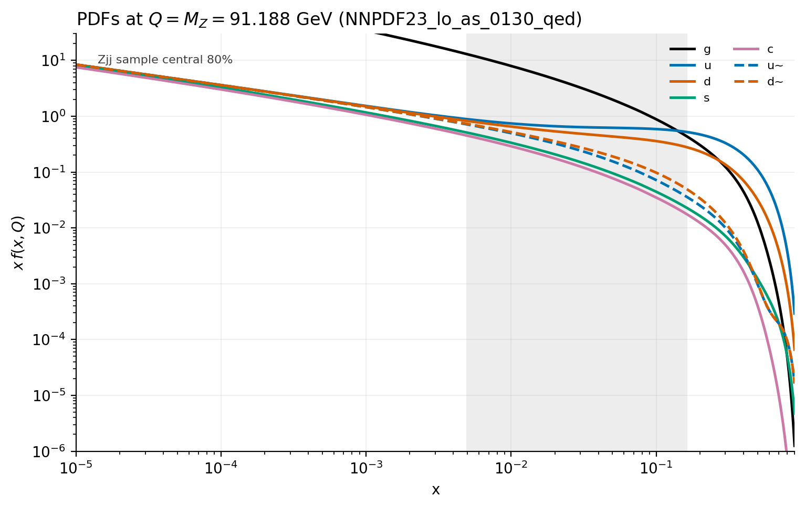
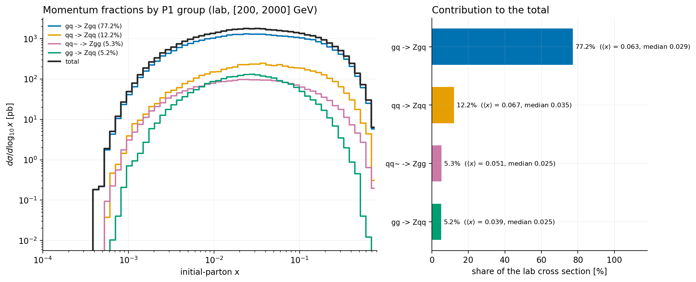
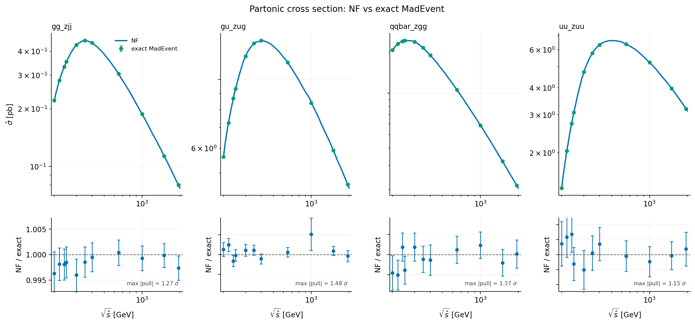
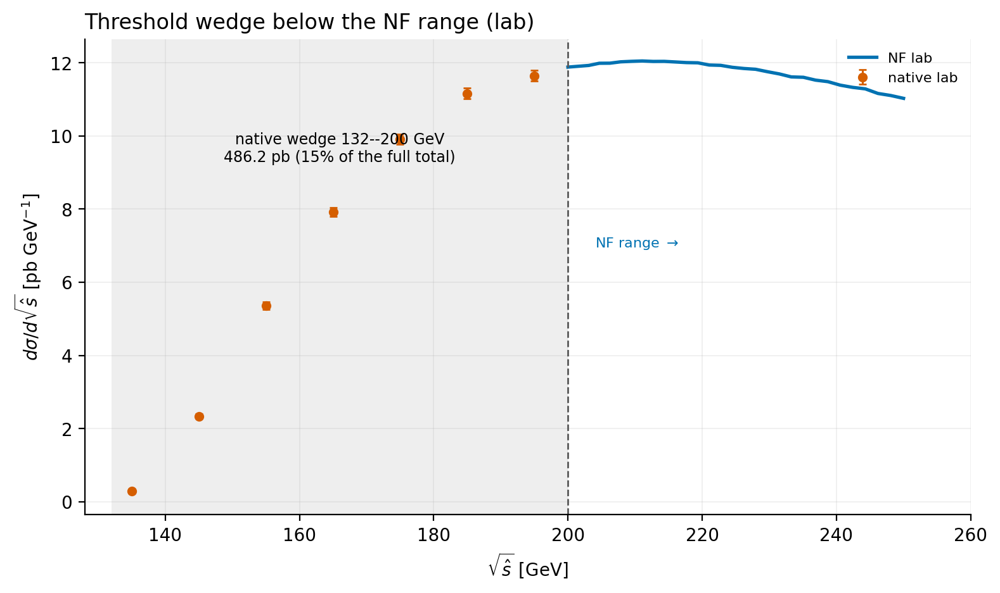
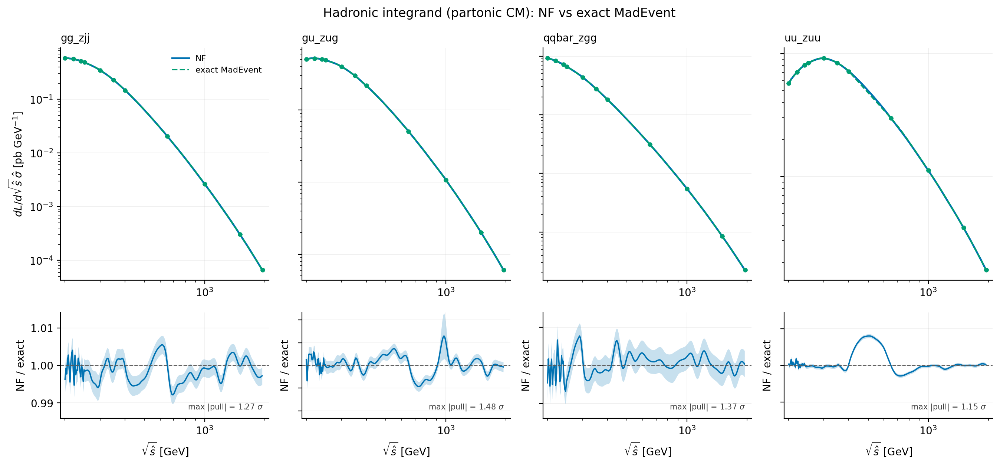
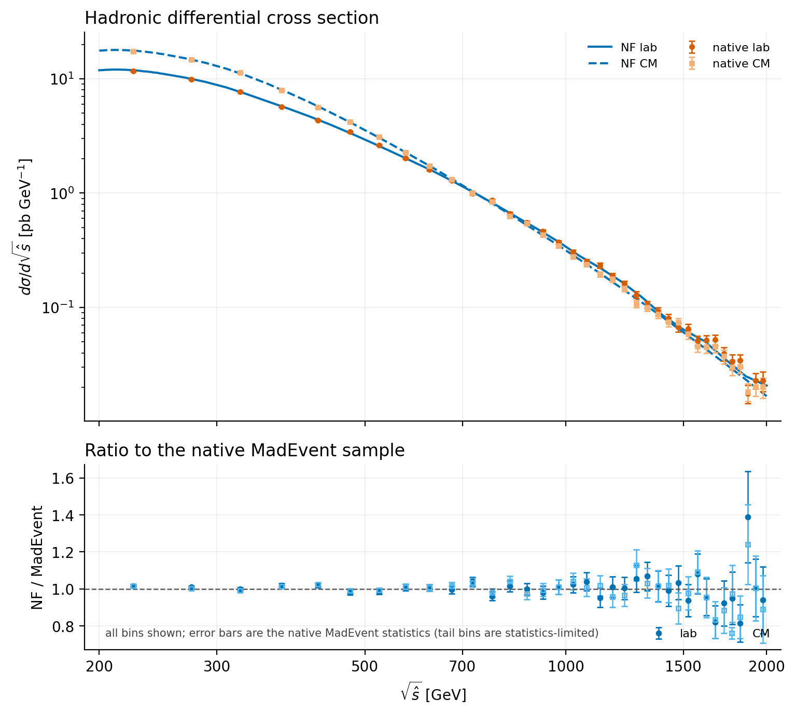
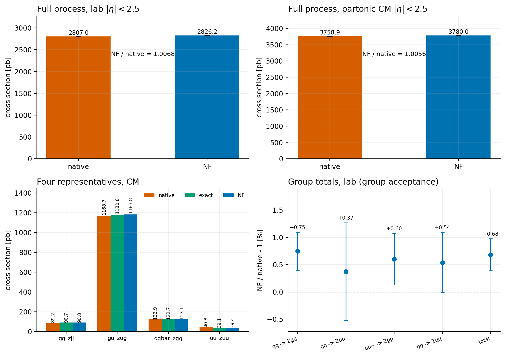
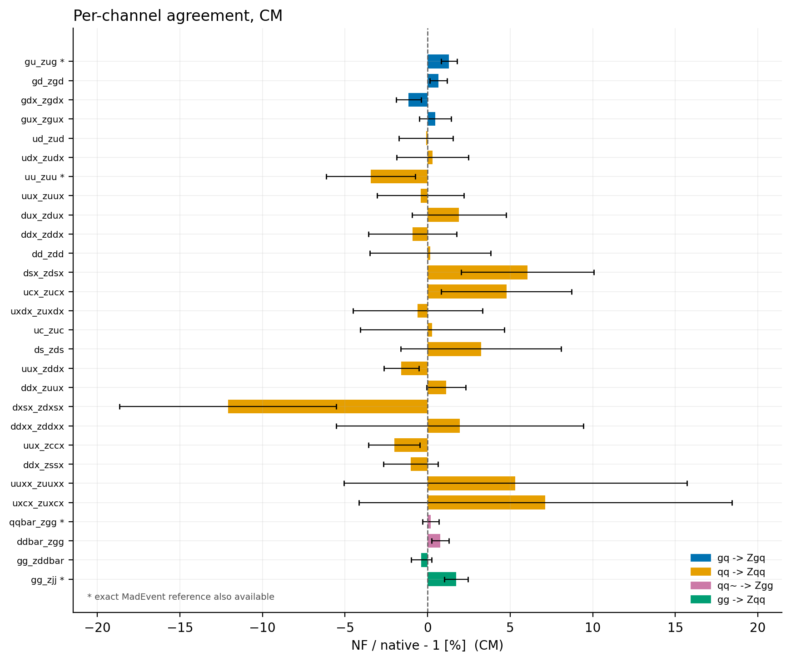
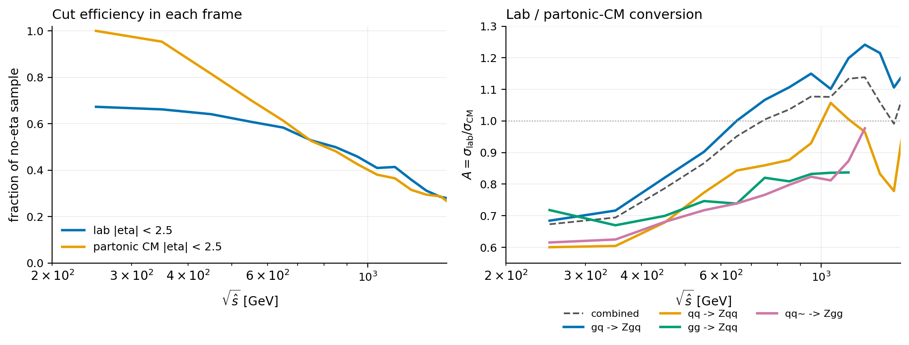

# Z + 2 jets with conditional normalizing flows — results

**Status report — 2026-11-19 (local Windows campaign)**

This is the Z+2 analogue of `FINDINGS.md`: the full LO `pp -> Z j j` process
computed three ways (native MadGraph, exact partonic + LHAPDF, conditional NF
+ LHAPDF), with the partonic channels, the frame conversion, the final
numbers, and the bugs found along the way.  The chronological run log is
[`ZJJ_NF_LOCAL.md`](ZJJ_NF_LOCAL.md); the server run plan is
[`ZJJ_RUN_PLAN.md`](ZJJ_RUN_PLAN.md).

## 1. Setting

- Process: `p p > z j j` at 13 TeV, LO, fixed scale 91.188 GeV, alpha_s = 0.130.
- PDF: `NNPDF23_lo_as_0130_qed` (LHAPDF ID 247000, MG5's `nn23lo1`).
- Cuts: `pT,j > 20 GeV`, `|eta_j| < 2.5`, `Delta R_jj > 0.4`, `m_jj > 20 GeV`.
- NF condition range: `sqrt(s_hat)` in [200, 2000] GeV, 5-D three-body phase space.

The native `p p > z j j` output splits into four phase-space groups and 28
distinct matrix elements (the full flavor list from the MadGraph matrix
headers).  The NF is trained per matrix element but the proposals are shared:
one model per topology covers both Z couplings and all charge states.  The
corresponding Feynman diagrams are the 28 `matrix*.ps` files in
`madgraph_baselines/z_2jet/SubProcesses/P1_*/`; viewable PDF copies of all
28, plus PNGs for the four representatives, are in
`results/zjj_three_methods/feynman_diagrams/` (its README maps every matrix
file to its process).

### 1.1 PDFs and the parton momentum fractions

At LO the hadronic cross section is

```text
sigma = sum_{a,b} int dx1 dx2 f_a(x1,Q) f_b(x2,Q) sigma_hat_ab(x1 x2 s),
```

with `Q = M_Z = 91.188 GeV` fixed.  The PDFs therefore control both the
parton luminosity and the x region each group probes.  The figures show
`x f(x,Q)` for the partons entering the 28 channels and the x distribution
of the two initial partons in the native sample, split by P1 group.  The
second figure plots `dsigma/dlog10(x)`, so the area under each group curve is
exactly that group's contribution to the lab cross section.



*`x f(x,Q)` at `Q = M_Z`.  The shaded band is the central 80% of the initial
partons of the Zjj sample (`x10 = 0.0049`, `x90 = 0.164`).*



*Left: `dsigma/dlog10(x)` per P1 group in the lab window; the area under each
curve is that group's cross section.  Right: group shares with the mean and
median x.*

| group | share of native lab cross section | mean x | median x |
|---|---:|---:|---:|
| gq -> Zgq | 77.2% | 0.063 | 0.029 |
| qq -> Zqq | 12.2% | 0.067 | 0.035 |
| qq~ -> Zgg | 5.3% | 0.051 | 0.025 |
| gg -> Zqq | 5.2% | 0.039 | 0.025 |

The sample peaks at `x ~ 0.03`: for `sqrt(s_hat)` = 200--500 GeV,
`x1 x2 = s_hat/s ~ 2--15 x 10^-4`, so both partons are typically at a few
percent.  The `gq` group dominates (77%) by pairing the large gluon density
at small x with a valence quark, and it has the largest partonic matrix
element.  The `qq -> Zqq` group sits at the largest x (mean 0.067), where
only valence/sea quarks are available.  The `gg` group sits at the lowest x
(mean 0.039), where the gluon PDF is largest, yet contributes only 5.2%;
the suppression is in the partonic matrix element and the smaller number of
`gg` channels, not in the parton luminosity.

## 2. Models

| model | channels covered | ESS | `std_logw` | wall time |
|---|---:|---:|---:|---:|
| `gg_zjj` | 2 (`gg` group) | 0.609 | 0.661 | 7 h 01 min |
| `gu_zug` | 4 (`gq` group) | 0.747 | 0.523 | 5 h 22 min |
| `qqbar_zgg` | 6 (`qq~ -> Zgg` + 4 `qq` annihilations) | 0.410 | 0.904 | 4 h 47 min |
| `uu_zuu` | 16 (`qq -> Zqq`) | 0.771 | 0.515 | 5 h 31 min |

All runs are the balanced profile (two adaptive KL rounds, chi-square fine
tuning), 10 edges, graph `0 <- 1 <- 2 <- 3 <- 4`.

**Model sharing** (ESS at 250/650/1950 GeV; no loss relative to the trained
channel):

| target | source | ESS |
|---|---|---|
| `gg_zddbar` | `gg_zjj` | 0.738 / 0.814 / 0.821 |
| `gd_zgd` | `gu_zug` | 0.748 / 0.842 / 0.842 |
| `gux_zgux` | `gu_zug` | 0.783 / 0.841 / 0.836 |
| `gdx_zgdx` | `gu_zug` | 0.774 / 0.837 / 0.840 |
| `ddbar_zgg` | `qqbar_zgg` | 0.682 / 0.692 / 0.662 |

The 20 `P1_qq_zqq` channels were assigned by a four-candidate ESS sweep:
`uu_zuu` for 16 channels (same-flavor 0.79-0.81, different-flavor 0.43-0.49)
and `qqbar_zgg` for the four annihilation-to-different-flavor channels
(0.37-0.45).

## 3. Partonic validation

200k-evaluation NF vs equal-budget uniform Monte Carlo, and NF vs exact
MadEvent at the six held-out energies.  NF vs exact (relative):

| model | worst relative difference | worst pull |
|---|---:|---:|
| `gg_zjj` | 0.31% | 2.1 sigma |
| `gu_zug` | 0.19% | 1.3 sigma |
| `qqbar_zgg` | 0.28% | 1.6 sigma |
| `uu_zuu` | 0.19% | 1.2 sigma |

Variance reduction over uniform MC reaches 52x / 2366x / 274x / 714x for the
four models respectively; the uniform sampler is essentially unusable for the
`gq` and `qq -> Zqq` channels (ESS down to 0.0026).

Hadronic validation of the four representatives, [200, 2000] GeV, no tail:

| channel | NF CM [pb] | exact CM [pb] | NF lab [pb] | exact lab [pb] |
|---|---:|---:|---:|---:|
| `gg_zjj` | 90.739 +/- 0.028 | 90.677 | 64.258 +/- 0.021 | 64.206 |
| `gu_zug` | 1182.389 +/- 0.429 | 1180.775 | 919.200 +/- 0.425 | 917.938 |
| `qqbar_zgg` | 122.948 +/- 0.042 | 122.735 | 78.838 +/- 0.030 | 78.704 |
| `uu_zuu` | 39.367 +/- 0.009 | 39.145 | 28.819 +/- 0.013 | 28.619 |

The same +0.1--0.6% NF/exact offset in CM and lab validates the acceptance
conversion independently of the native sample.

On the 60-point integration grids used for the convolution (40k NF
evaluations per point), the same comparison gives max |pull| =
1.27 / 1.48 / 1.37 / 1.15 sigma for the four models; the figure shows the
ratios with the NF reconstruction error included.



*Partonic cross section for the four representatives: NF (line) against the
dedicated MadEvent scans (points).  The lower row is NF/exact with the
combined NF-reconstruction and MadEvent errors.*

## 4. Three-method comparison: native, exact, NF

The same cross section is computed three ways:

- **native MadGraph** -- the no-eta LHE sample (756k events).  Each event is
  assigned to one of the 28 partonic channels by its initial/final flavour
  pair, and the `|eta| < 2.5` jet cut is applied in the lab or in the
  partonic CM.
- **exact MadEvent + LHAPDF** -- the dedicated partonic scans
  `sigma_hat(sqrt(s_hat))` multiplied by the LHAPDF luminosity and
  integrated.  Available for the four representatives only.
- **conditional NF + LHAPDF** -- the flow integrand over the 5-D three-body
  phase space, all 28 channels.

All entries below are in the [200, 2000] GeV window (the NF condition range),
so the columns are like-for-like.  The full 28-channel NF run used 67.2M
samples and took 80 min.

### 4.1 Totals

| method | lab, `|eta|<2.5` | partonic CM, `|eta|<2.5` |
|---|---:|---:|
| native MadGraph (613,987 events in window) | 2807.04 +/- 8.15 pb | 3758.93 +/- 9.44 pb |
| exact MadEvent + LHAPDF | -- (4 representatives only) | -- |
| conditional NF + LHAPDF | **2826.21 +/- 0.66 pb** | **3779.99 +/- 0.64 pb** |
| **NF / native** | **1.00683** (pull 2.34) | **1.00560** (pull 2.22) |

The native sample also contains `sqrt(s_hat) > 2000 GeV` events, which the NF
does not cover.  Adding that tail (8.77 pb lab, 7.91 pb CM) to both methods
gives the full-range rows:

| quantity, `sqrt(s_hat) > 200 GeV` | lab | CM |
|---|---:|---:|
| native MadGraph | 2815.82 +/- 8.17 pb | 3766.84 +/- 9.46 pb |
| NF (window + native tail) | 2834.99 +/- 0.85 pb | 3787.90 +/- 0.82 pb |
| ratio | 1.00681 | 1.00559 |

> **Window correction.**  An earlier draft compared the NF [200, 2000]
> integral with `lab_gt200_pb` / `cm_gt200_pb`, which include the
> `sqrt(s_hat) > 2000` tail; adding the tail to that comparison then
> double-counted it on the native side.  The like-for-like native references
> are 2807.04 pb (lab) and 3758.93 pb (CM), so the ratio is 1.0068, not
> 1.0037.  The pull is 2.3 sigma; the offset is the same +0.2--0.8% seen in
> every group.

### 4.2 Representative channels

The four channels with dedicated exact scans, all three methods.  CM is the
clean per-channel comparison; the lab entries are discussed below.

| channel | group | native CM | exact CM | NF CM | NF/exact | NF/native |
|---|---|---:|---:|---:|---:|---:|
| `gg_zjj` | `gg` | 89.23 +/- 0.63 | 90.68 | 90.78 | 1.0011 | 1.0174 |
| `gu_zug` | `gq` | 1168.69 +/- 5.50 | 1180.78 | 1183.84 | 1.0026 | 1.0130 |
| `qqbar_zgg` | `qq~` | 122.88 +/- 0.61 | 122.73 | 123.11 | 1.0031 | 1.0019 |
| `uu_zuu` | `qq` | 40.82 +/- 1.14 | 39.14 | 39.42 | 1.0072 | 0.9657 |
| **sum of four** | | **1421.62 +/- 5.68** | **1433.33** | **1437.15** | **1.0027** | **1.0109** |

The exact column is the PCHIP convolution of the 11 MadEvent points
(`results/zjj_exact_convolution.json`).  The NF values are from the full
28-channel run; the dedicated single-channel runs in §3 agree within 0.15%.
NF/exact agreement is 0.1--0.7%; the native per-channel entries fluctuate by
1--2 sigma (largest: `uu_zuu`, +4.3% over exact, 1.5 sigma), which is why the
sum is less precise than either calculation.

**Lab frame.**  The exact and NF lab entries apply one acceptance factor per
P1 group, while the native lab entry is the true per-channel value.  Within
a group the acceptance varies with the channel (for `gu_zug` the native
lab/CM ratio is 0.743 against the group's 0.769), so per-channel lab values
are not like-for-like.  The lab comparison is made at group and total level.

### 4.3 Groups and the lab total

| group | NF lab [pb] | share | native lab [pb] | NF/native lab | NF/native CM |
|---|---:|---:|---:|---:|---:|
| `P1_gq_zgq` | 2184.18 | 77.3% | 2167.97 +/- 7.47 | 1.00748 | 1.00626 |
| `P1_qq_zqq` | 344.75 | 12.2% | 343.47 +/- 3.07 | 1.00372 | 1.00240 |
| `P1_qq_zgg` | 150.43 | 5.3% | 149.53 +/- 0.70 | 1.00600 | 1.00464 |
| `P1_gg_zqq` | 146.86 | 5.2% | 146.07 +/- 0.80 | 1.00539 | 1.00536 |
| **total** | **2826.21** | 100% | **2807.04 +/- 8.15** | **1.00683** | **1.00560** |

Every group is +0.2--0.8% high, consistent with the total.  The `qq_zqq`
group is no longer an outlier once the `sqrt(s_hat) > 2000` tail is removed
from the native reference; the earlier 0.8% deficit was the tail.

**Threshold wedge.** The NF models cover `sqrt(s_hat) > 200 GeV`.  The native
lab cross section in 132--200 GeV is **486.2 +/- 3.1 pb** (15% of the
3302.0 pb event-sample total).  Adding the native wedge to the NF full-range
estimate gives 2834.99 + 486.2 = **3321.2 pb**, against the native event sum
of 3302.0 pb (+0.58%).  The official MadGraph full cross section is
3311.7 +/- 3.75 pb, 9.7 pb (0.29%) above the event sum, within the sample
statistics.



*Native lab differential cross section below the NF range.  The shaded
132--200 GeV wedge contributes 486.2 pb; the NF starts at 200 GeV.*

### 4.4 Figures



*Hadronic integrand `dL/dsqrt(s_hat) x sigma_hat` in the partonic CM for the
four representatives.  The shaded band is the NF reconstruction error; the
exact curve is the PCHIP of the scan points.*



*Top: differential cross section in the lab window, NF against the binned
native sample (lab and CM).  Bottom: bin-by-bin NF/MadEvent ratio for both
frames, with the native statistical error; all bins are shown, so the tail
bins are visibly statistics-limited.*



*Totals and representative channels.  Top: the full 28-channel process in
lab and CM.  Bottom left: the four representatives with all three methods in
CM.  Bottom right: group-level lab ratios, the level at which the
group-acceptance conversion is defined.*



*Per-channel NF/native deviation in CM with the native statistical error.
Stars mark the channels with a dedicated exact scan; their 0.1--0.7%
NF/exact agreement is well below the native per-channel statistics.*

## 5. Frame acceptance (the Z+2 analogue of Fix 2)

The `|eta| < 2.5` cut is applied in the lab by MadGraph and in the partonic
CM by the NF.  From the native no-eta sample (755,797 events):

| quantity | >200 GeV |
|---|---:|
| no eta cut | 4577.8 pb |
| lab `|eta|<2.5` | 2815.8 pb |
| CM `|eta|<2.5` | 3766.8 pb |
| lab / CM | **0.7475** |

Per-group factors: gq 0.769, gg 0.708, qq_zqq 0.692, qq_zgg 0.640.  The
conversion is applied per group and per `sqrt(s_hat)`
(`--acceptance-dir results/zjj_acceptance`).  The frame correction is 25% on
average and the group factors span 20% (0.64--0.77), far more
channel-dependent than the 0.05% single-vs-per-channel spread in Z+1.



*Left: fraction of the no-eta sample surviving the jet `|eta| < 2.5` cut in
each frame, per `sqrt(s_hat)` bin.  Right: the lab/CM conversion factor per
P1 group; the dashed curve is the all-channel average.*

## 6. Bugs found and fixed

1. **Missing `alpha_s`** in three existing configs (`gu_zug`, `qqbar_zgg`,
   `uu_zuu`) - they would have trained at 0.118 against the 0.130 baseline.
2. **Identical-parton luminosity double count**: the driver summed both beam
   orderings for `gg`, `uu`, `dd`, `u~u~`, `d~d~`, doubling those channels.
3. **Matrix10/15 final-flavor multiplicity**: `uux_zddx` and `ddx_zuux` each
   contain two final flavor options with identical amplitudes; counting only
   the initial pair made both channels half the native rate.  Fixed with
   `multiplicity = 2`.
4. **Acceptance bin truncation**: `int((shat - bin_min)/width)` folded events
   below 200 GeV into bin 0; fixed with an explicit range check.
5. **Windows build traps**: MG5 `make` dropping `TEMP`/`TMP`; `python3` without
   `six`; broken `coupl.inc` symlinks; CRLF `make_opts` (fixed in
   `madgraph_windows_build.py`, `setup_madgraph_process.py`, `prepare_run.py`).

The earlier `results/zj_hadronic_integral/summary.json` (13765.5 pb) predates
the `xfxQ` -> `xfxQ2` fix and is superseded.

## 7. Caveats and next steps

- The NF covers `sqrt(s_hat) > 200 GeV`; the 132--200 GeV threshold wedge is
  taken from native for a full-range number.  A low-range model (140--250 GeV)
  would remove this external input.
- The native event-based per-channel reference has its own PDF/flavor
  treatment and 0.3% total statistics (1--5% per channel); the exact partonic
  convolution is the cleaner per-channel reference and agrees with the NF at
  0.1--0.7%.
- The exact and NF lab entries use one acceptance factor per P1 group, so
  per-channel lab values are approximate.  Per-channel acceptance tables
  would close the residual; the group totals are unaffected at the quoted
  precision.
- The ZZ/WW backgrounds and detector effects are outside this LO study.

## 8. Reproduction

```bash
# environment
export LHAPDF_DATA_PATH=/path/to/lhapdf/share/LHAPDF
# native sample: one full-process MG5 run (all 28 matrix elements, 4 P1 groups)
#   cards:  madgraph_baselines/z_2jet/Cards/proc_card_mg5.dat, run_card.dat
#   launch: madgraph_baselines/run_z2j.mg5  (etaj = 2.5, official 3311.7 pb)
#   no-eta: madgraph_baselines/z_2jet/noeta_commands.txt  (5301 pb, 756k events)
cd /path/to/MG5_aMC_v3_6_7
./bin/mg5_aMC /path/to/madgraph_baselines/run_z2j.mg5
# no-eta survey inside the z_2jet output: import z_2jet/noeta_commands.txt
# train the four models (run from each standalone dir)
python -u experiments/run_madgraph_process_conditional_copula.py \
  --config configs/processes/<model>.json --speed-profile balanced \
  --device cuda --batch-size 30000 --is-points 128 --me-chunk 512 \
  --me-workers 6 --output results/<model>_copula_balanced_gpu
# full integration
python -u experiments/integrate_hadronic_process.py \
  --low-config configs/processes/zjj_hadronic.json \
  --high-config configs/processes/zjj_hadronic.json \
  --split 250 --grid-low-points 30 --grid-high-points 30 \
  --nf-evals 40000 --acceptance-dir results/zjj_acceptance \
  --tail-pb 8.7745 --tail-error-pb 0.5341 --device cuda \
  --output results/zjj_hadronic_integral_full_v2
# analysis and figures
python scripts/zjj_analyze.py --integral-dir results/zjj_hadronic_integral_full_v2 \
  --output results/zjj_analysis_v2
# native per-channel decomposition, exact overlay, three-method figures
python scripts/zjj_three_methods.py \
  --figure-dir ../madgraph_test/results/zjj_three_methods
# per-channel table: results/zjj_three_methods/channel_table.csv
# PDFs and the momentum-fraction distribution
python scripts/zjj_pdf_x.py \
  --figure-dir ../madgraph_test/results/zjj_three_methods
```

## 9. Computing time

Local Windows workstation: 1x RTX 3060 (6 GB), 16 CPU cores.  Training wall
time includes setup, marginal fits, bridge, two KL rounds and the chi-square
stage, and uses `--me-workers 6`:

| model | wall time |
|---|---:|
| `gg_zjj` | 7 h 01 min |
| `gu_zug` | 5 h 22 min |
| `qqbar_zgg` | 4 h 47 min |
| `uu_zuu` | 5 h 31 min |
| **training total** | **22 h 41 min** |

Other measured steps (sums of the drivers' own timers):

| step | time |
|---|---:|
| 200k validation, 4 models (NF + uniform) | 13 min |
| exact MadEvent scans, 11 points x 4 channels | 4 h 33 min |
| dedicated per-channel integrations (CM + lab) | 1 h 56 min |
| full 28-channel integration, v1 + v2 | 2 h 38 min |
| ESS sweep (20 channels x 4 models x 3 energies) | ~15 min (not instrumented) |
| **measured total** | **~32 h** |

The exact scans and dedicated integrations overlapped with training on
separate cores, so the campaign wall clock was ~26 h (02:40 on 11/16 to
~04:50 on 11/17).  For comparison, the Z+1 campaign trained 12 models in
4.30 h of summed job time on 4 GPUs (48 CPUs each) on the Linux cluster.
